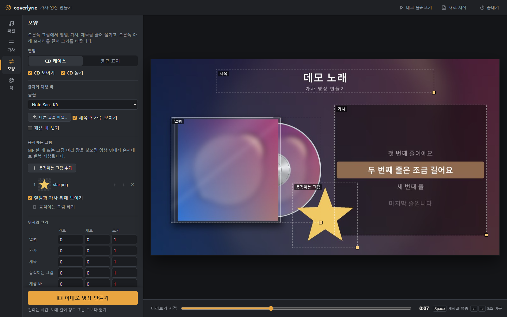
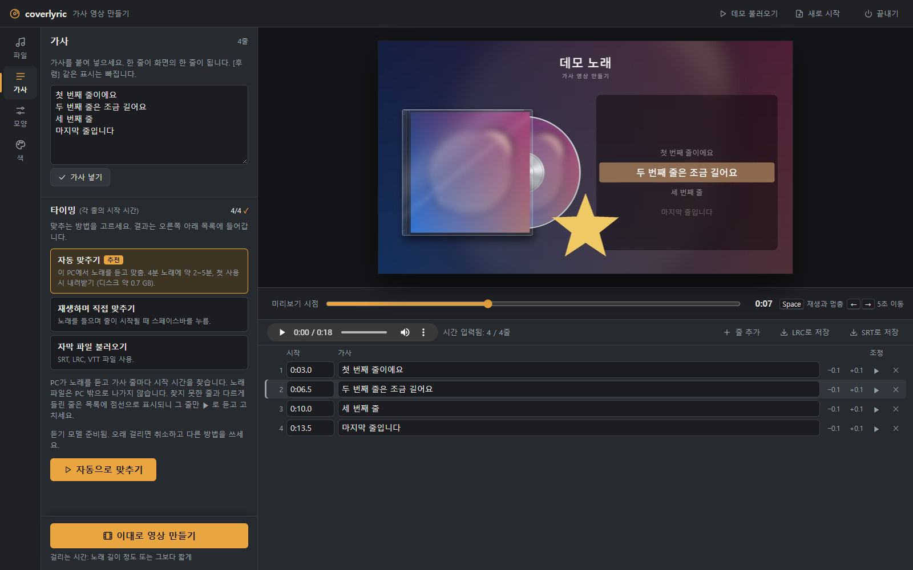

# coverlyric

[한국어 (README.md)](README.md)

A Windows program that makes a lyric video (mp4) from a song, an album cover and the lyrics. It
runs on your PC and is used from a page in your browser.

**[Download coverlyric (ZIP)](https://github.com/NaNIsaac/coverlyric/archive/refs/heads/main.zip)**, unzip it and double-click `가사영상 만들기.bat`. The steps are under [Usage](#usage).



- [Usage](#usage): from install to a finished video
- [Developers and advanced use](#developers-and-advanced-use): command line, project file, tests,
  how it works

# Usage

## Requirements

- A Windows 10 or 11 PC
- The song: mp3, wav, m4a, flac, ogg
- The cover: png, jpg, webp (square recommended)
- The lyrics as text

**Minimum:** Windows 10/11 64-bit, 4 GB RAM, 2 CPU cores, 500 MB free disk for the first start;
automatic timing needs about 0.7 GB more disk once. A working H.264 encoder on the graphics card (NVIDIA,
Intel, AMD) compresses the video; otherwise the CPU does. Automatic timing uses about
1 GB of memory, and a render 0.4 to 0.9 GB depending on the free memory
([measurements](#memory-and-speed)).

## Install and start

1. Download [coverlyric-main.zip](https://github.com/NaNIsaac/coverlyric/archive/refs/heads/main.zip).
2. Right-click the file and choose **Extract All**.
3. Open the `coverlyric-main` folder (and the folder of the same name inside it, if there is one).
4. Double-click `가사영상 만들기.bat`. A terminal window opens and shows progress.
5. The first start downloads [uv](https://docs.astral.sh/uv/), Python, ffmpeg and the packages (about
   150 MB, about 300 MB on disk, usually one to three minutes). No administrator rights are needed.
   Keep the terminal window open.
6. The page opens in your browser. Later starts take a few seconds.

If Windows shows "Windows protected your PC", choose **More info**, then **Run anyway**.
**데모 불러오기** (load demo) loads a short demo song, cover and four lines.

## Make a video

The controls sit in four groups on the left rail: **파일** (files), **가사** (lyrics and timing),
**모양** (look) and **색** (colour). Only the chosen group is open, and **이대로 영상 만들기** (make)
stays at the bottom whatever the group. A red dot marks a group that still lacks something.

1. **Song and cover:** pick the song and the cover. A crop window opens for the cover: drag the
   square, drag its corner to resize, use **확대** (zoom), then press **확인** (OK). Type the title and
   the artist (left empty, the artist is not shown).
2. **Lyrics** (the 가사 group): paste the lyrics, one screen line per line. Tags such as `[Chorus]` are removed.
3. **Timing**, lower in the 가사 group, three ways; each fills the timing list that opens under the preview with that group, where a line can be
   nudged by 0.1 s, played from just before it, or typed as `10`, `10.5`, `1:05`, `1:05.3` or
   `0:01:05`:

   | Way | Time | Song sent anywhere |
   |---|---|---|
   | Automatic, on this PC (recommended) | about 2 to 5 min for a 4-min song | no |
   | Play and tap: <kbd>Space</kbd> as each line starts, <kbd>Backspace</kbd> undoes | song length | no |
   | Import an SRT, LRC or VTT file | at once | no |

   Automatic timing listens to the song on the CPU with faster-whisper `small` and places your own
   lyrics on the heard words. The first use installs it and downloads the 464 MB model (about
   0.7 GB of disk). A progress bar shows the phase, percent and time left, found lines fill the
   list as it goes, and **취소** (cancel) puts the old list back. Lines it could not place, lines
   less than 1 s after the previous one, and lines heard differently are marked with a dashed
   border and a note, so only those need checking. On a 12-thread PC a 3 min 48 s song with 63
   lines took about 2 min and 1.04 GB; 59 lines were within 1 s and 38 within 0.3 s.

   

   Imported lines are checked against your lyrics, and lines that differ are marked. Without a
   subtitle file, a ready prompt can be copied into a chat AI and its SRT pasted back; that sends
   the song to the AI service, and its times are often wrong.
4. **Look:** the cover sits in a clear CD case with the disc half out and turning (both
   switchable), or as a round cover. Drag the album, the lyrics, the title and the playback bar on
   the preview to move them, and drag a corner to resize. Pick the font; the band colour,
   background blur and darkness are in the 색 (colour) group. **움직이는 그림** (moving picture) adds one GIF or several images (png, jpg,
   webp) that loop over the video: reorder them with ↑ ↓, set the frames per second, choose above
   or under the album and lyrics, and drag it on the preview.
5. **Render:** press **이대로 영상 만들기**. While it renders, the page shows how far into the song
   the video is made (for example 0:04 / 0:18), the lyric line at that point, the percent and the
   time left. It usually takes less than the song's length, depending on the PC.

The `만든 영상` folder then holds the mp4 (1920x1080, 30 fps, H.264 + AAC), a 1280x720 thumbnail,
and the timing as LRC and SRT. Press **끝내기** on the page or close the terminal window to quit;
work is saved and reopens where you left off.

Tips:

- Each group title shows its state (for example 노래 ✓ 표지 ✓, 4줄, 4/4 ✓).
- The preview follows the song while it plays. <kbd>Space</kbd> plays and pauses, <kbd>←</kbd>
  <kbd>→</kbd> move 5 s (outside text boxes). Clicking a row of the timing list moves the preview
  to that line.
- Drop a file anywhere on the window: the song, a cover photo (the crop window opens), an SRT,
  LRC or VTT file, lyrics as TXT, or a font. Images dropped on the moving picture box become
  moving picture frames.
- Deleting a row shows **되돌리기** (undo) in the notice for a moment.

## Problems

| Symptom | Action |
|---|---|
| Nothing happens on double-click | Run it from the unzipped folder, not from inside the ZIP. |
| "디스크 공간 부족" (not enough disk space) | Free space on the named drive and start again. The first start needs 500 MB. |
| "내려받기 실패" / "설치 실패" (download or install failed) | Check the internet connection and start again. |
| "프로그램이 오류로 끝났습니다" (ended with an error) | Read the error in the terminal window; if it persists, post it as an [issue](https://github.com/NaNIsaac/coverlyric/issues). |
| The browser does not open | Paste the `http://127.0.0.1:...` address from the terminal window into the browser. |
| Letters show as boxes | The font has no Korean; pick another font. |
| "자동 맞추기 실패" (automatic timing failed) | Read the reason shown. If install or download failed, check the internet connection and press it again; play-and-tap works meanwhile. |
| "영상 만들기 실패" (render failed) | The reason and what to do show under the make button. A stopped worker means too little memory: close other programs and render again. The log is `coverlyric.log` in the program folder. |

# Developers and advanced use

## Run with uv

With [uv](https://docs.astral.sh/uv/) installed, from the repository folder:

<!-- test -->
```sh
uv run coverlyric still src/coverlyric/demo/demo.json --at 7 --out demo-still.png
```

This draws one frame of the demo song. `가사영상 만들기.bat` runs `tools/start.ps1`, which checks
free disk space, installs uv into `%LOCALAPPDATA%\coverlyric\uv` when it is missing, and runs
`uv run --frozen --no-dev coverlyric`.

## Command line

```sh
uv run coverlyric                         # open the page (the default)
uv run coverlyric app --home <folder>     # keep work and videos in <folder>
uv run coverlyric still <project.json> --at 30 --out still.png
uv run coverlyric render <project.json> --out video.mp4 [--clip 10,20]
```

## Project file

A project file is what the page saves in `작업 중/project.json`: paths to the song and cover, the
lines with their start times, and the style. Finished videos go to `만든 영상/`.

## Fonts

The bundled fonts are under the SIL Open Font License 1.1; each licence is next to its font in
`src/coverlyric/fonts/`:

| Font | Licence file |
|---|---|
| Noto Sans KR | `OFL-NotoSansKR.txt` |
| NanumGothic Bold | `OFL-NanumGothic.txt` |
| Do Hyeon | `OFL-DoHyeon.txt` |
| Black Han Sans | `OFL-BlackHanSans.txt` |
| Nanum Brush Script | `OFL-NanumBrushScript.txt` |
| East Sea Dokdo | `OFL-EastSeaDokdo.txt` |

The page also lists the fonts installed on the PC that can write Korean, and takes any font file.

## Tests

```sh
uv run pytest
```

## How it works

- The page is served by a local web server on `127.0.0.1` only.
- Frames are drawn with Pillow and piped to ffmpeg (from the imageio-ffmpeg package), which writes
  an H.264 + AAC mp4. Layers that do not move are drawn once, equal frames are reused, and worker
  processes draw 4 frames at a time into shared memory; only a few such chunks are in memory at
  once.
- The encoder is the first of h264_nvenc, h264_qsv and h264_amf that works on this PC, else
  libx264. The `COVERLYRIC_ENCODER` environment variable picks one.
- The number of workers follows the memory free when the render starts: 250 MB kept back,
  then one worker per 150 MB, at most the cores minus one and 6, at least 1. The
  `COVERLYRIC_WORKERS` environment variable sets it by hand.
- Render start, progress every 10 %, the end and any error (with the exit code and reason) go to
  the terminal window and to `coverlyric.log` in the program folder.
- Automatic timing installs the optional `auto` extra (faster-whisper) on first use with
  `uv run --extra auto`, transcribes the song on the CPU in a separate process, and matches your
  lyrics letter by letter to the word times. The text on screen is always your lyrics; the
  transcription only gives times.

## Memory and speed

Measured on a PC with a 12-thread CPU and 32 GB RAM (2026-11-18, encoder fixed to libx264). Memory
is the peak of the summed private memory of the python processes and ffmpeg.

| Song | Workers | Time | Peak memory |
|---|---|---|---|
| Demo, 18 s | 1 | 14.2 s | 416 MB |
| Demo, 18 s | 2 | 9.0 s | 518 MB |
| Demo, 18 s | 4 | 7.0 s | 775 MB |
| 60 s part of a song | 1 | 28.9 s | 428 MB |
| 60 s part of a song | 2 | 20.3 s | 552 MB |
| 60 s part of a song | 4 | 16.9 s | 861 MB |

A slower CPU takes longer; memory stays about the same. On a PC with 8 GB RAM and 12 threads, a
60 s part took about 73 s with 2 workers and about 60 s with 4. With less than 550 MB free the
render uses one worker.

Automatic timing (the 32 GB PC, a 3 min 48 s song, model already downloaded): `small` about 120 s,
1.04 GB at most.

## Licence

MIT for the code (`LICENSE`); the fonts keep their own licences.
