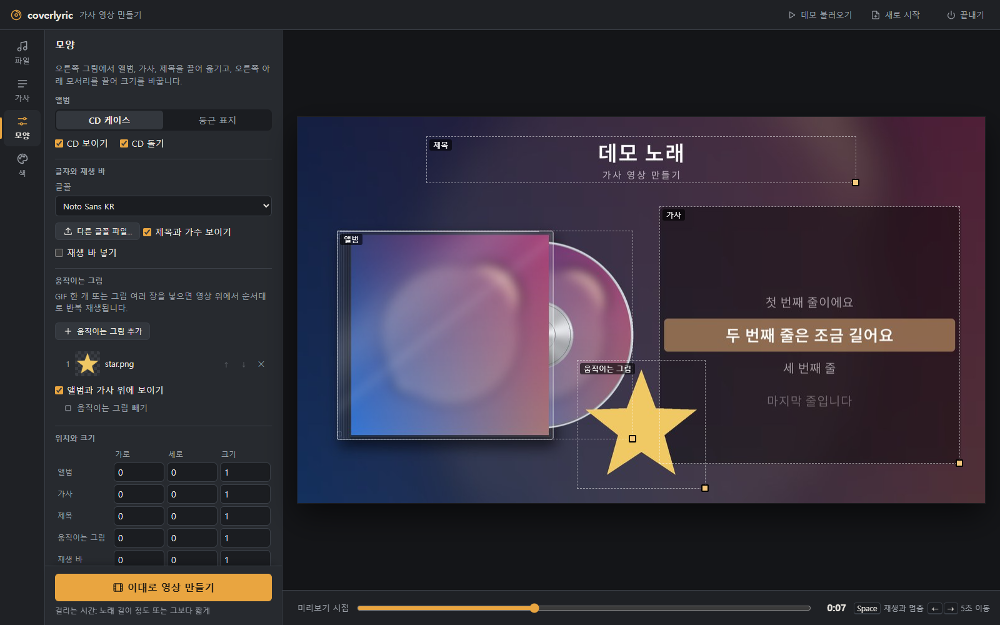
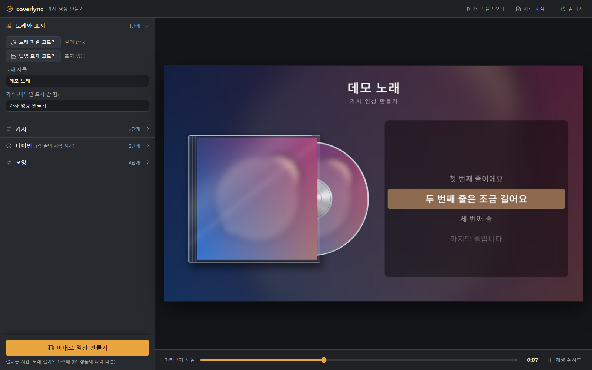
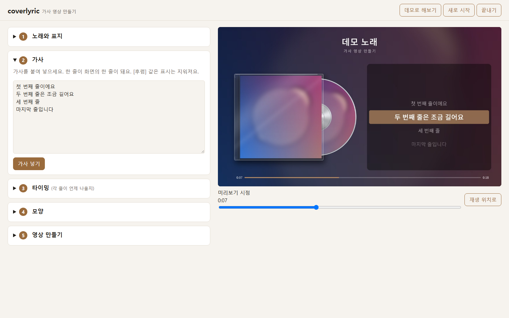
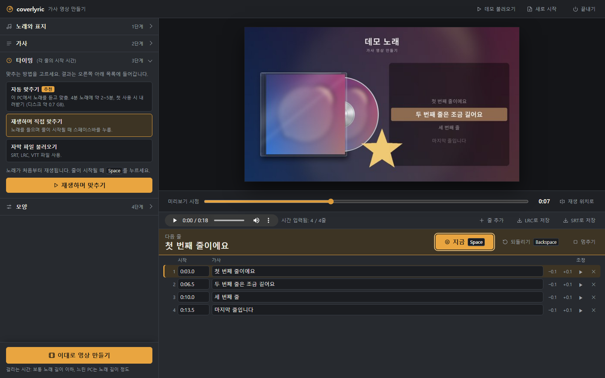
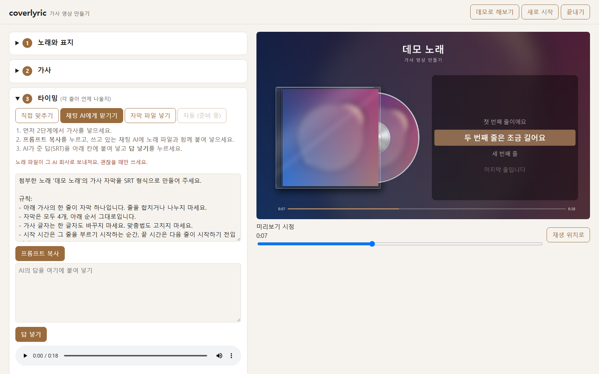
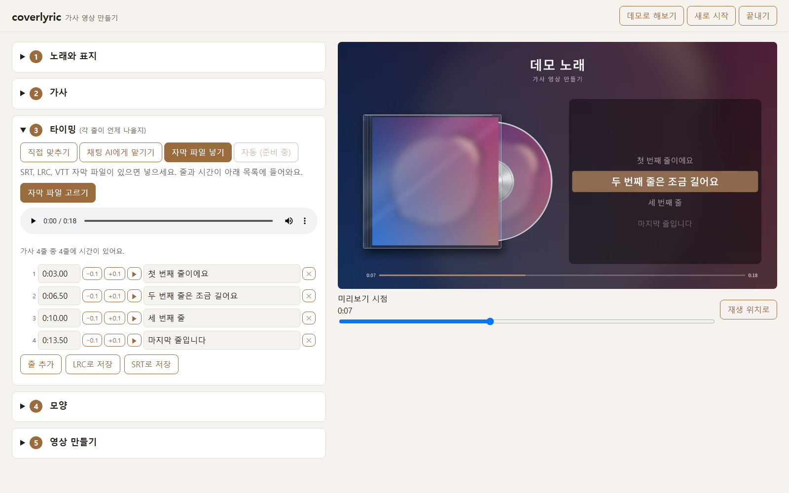
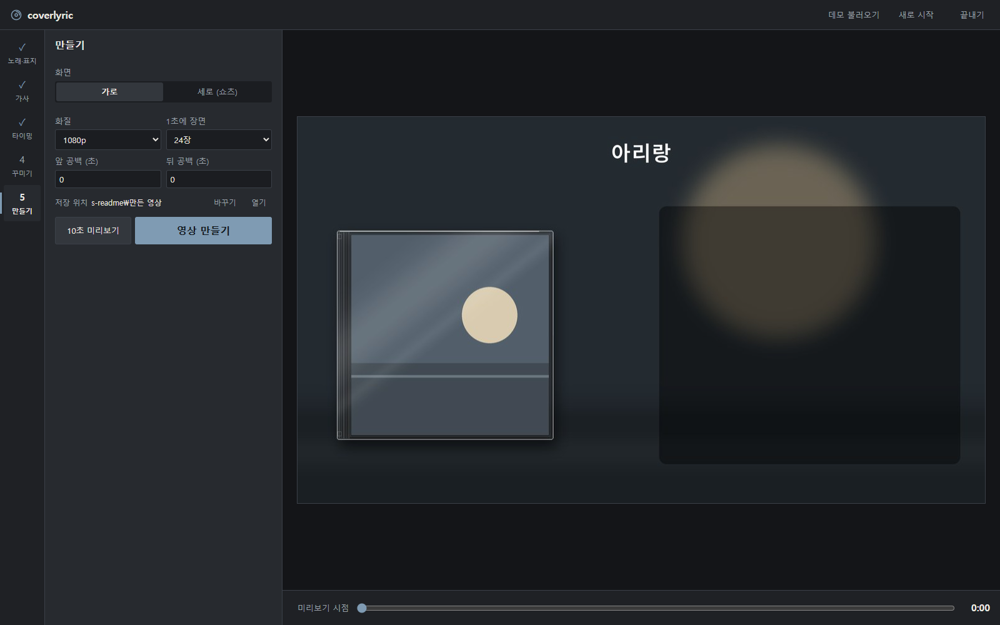

# coverlyric 가사 영상 만들기

[English README](README.md)

노래 파일, 앨범 표지, 가사만 있으면 가사가 흘러가는 영상을 만들어 주는 프로그램이에요.
내 컴퓨터 안에서 돌아가고, 인터넷 창(브라우저)에서 버튼을 눌러 쓰면 돼요. 코딩은 몰라도 돼요.

## 준비물

- 윈도우 컴퓨터 (윈도우 10 또는 11)
- 노래 파일 (mp3, wav, m4a, flac, ogg)
- 앨범 표지 그림 (png, jpg). 정사각형이 가장 좋아요.
- 가사 글

## 1. 내려받기와 처음 실행

1. 이 페이지 위쪽의 초록색 **Code** 버튼을 누르고 **Download ZIP**을 누르세요.
2. 내려받은 ZIP 파일을 오른쪽 클릭하고 **압축 풀기** (또는 **모두 압축 풀기**)를 누르세요.
   바탕 화면이나 문서 폴더처럼 찾기 쉬운 곳에 풀면 좋아요.
3. 풀린 폴더를 열고 **`가사영상 만들기.bat`** 을 두 번 클릭하세요.
4. 까만 창이 뜨고 글이 나와요. **처음 한 번은** 필요한 프로그램을 내려받느라 몇 분 걸려요.
   까만 창은 닫지 말고 기다리세요.
5. 준비가 끝나면 인터넷 창이 저절로 열리고 **가사 영상 만들기** 화면이 나와요.

> **"Windows의 PC 보호" 파란 창이 뜨면:** **추가 정보**를 누르고 **실행**을 누르세요.
> 인터넷에서 받은 파일이라 한 번 묻는 거예요.
>
> **백신이 막으면:** 이 폴더를 백신의 예외(허용 목록)에 넣거나, 백신 알림에서 **허용**을 누르세요.

다음부터는 `가사영상 만들기.bat` 을 두 번 클릭하면 몇 초 만에 열려요.

처음이면 오른쪽 위 **데모로 해보기**를 눌러 보세요. 연습용 노래와 표지, 가사 네 줄이 들어와서
모든 단계를 바로 눌러 볼 수 있어요.

## 2. 노래와 표지 넣기

1. **노래 파일 고르기**를 누르고 노래를 고르세요.
2. **앨범 표지 고르기**를 누르고 그림을 고르세요. 오른쪽에 미리보기가 나와요.
3. **노래 제목**과 **가수**를 쓰세요. 가수 칸을 비워 두면 화면에 안 나와요.

## 3. 가사 넣기

1. 가사를 복사해서 칸에 붙여 넣으세요 (붙여 넣기: <kbd>Ctrl</kbd> + <kbd>V</kbd>).
2. 한 줄이 화면의 한 줄이 돼요. 너무 긴 줄은 미리 둘로 나눠 주세요.
3. `[후렴]`, `[Chorus]` 같은 표시는 저절로 빠져요.
4. **가사 넣기**를 누르세요.

## 4. 타이밍 맞추기 (각 줄이 언제 나올지)

세 가지 방법 중 편한 걸 고르세요. 어느 방법이든 결과는 아래 같은 목록에 들어오고,
거기서 고칠 수 있어요.

### 방법 1: 직접 맞추기

1. **직접 맞추기** 탭에서 **처음부터 맞추기**를 누르세요. 노래가 처음부터 나와요.
2. 다음에 부를 줄이 노란색으로 표시돼요. 그 줄을 **부르기 시작할 때**
   <kbd>스페이스바</kbd>를 누르세요 (또는 **지금!** 버튼).
3. 끝까지 하면 모든 줄에 시간이 들어가요.
4. 조금 늦거나 빠른 줄은 목록에서 **−0.1** (더 빨리) / **+0.1** (더 늦게)로 고치고,
   **▶** 를 눌러 그 줄 조금 앞부터 들어 보세요.
5. 시간 칸에 `1:23.45` 처럼 직접 써도 돼요.

### 방법 2: 채팅 AI에게 맡기기

평소 쓰는 채팅 AI(노래 파일을 받을 수 있는 것)에게 시간을 맞춰 달라고 하는 방법이에요.

> **알아 두세요:** 이 방법은 노래 파일이 그 AI 회사로 보내져요. 괜찮을 때만 쓰세요.
> 방법 1과 3은 내 컴퓨터 밖으로 아무것도 보내지 않아요.

1. 먼저 3단계에서 가사를 넣으세요.
2. **채팅 AI에게 맡기기** 탭을 누르면 부탁할 글(프롬프트)이 만들어져 있어요.
   **프롬프트 복사**를 누르세요.
3. 채팅 AI를 열고, 노래 파일을 올리고, 복사한 글을 붙여 넣고 보내세요.
4. AI가 `1`, `00:00:03,000 --> 00:00:06,000` 같은 줄이 있는 답(SRT)을 줘요. 그 답을 전부 복사하세요.
5. 프로그램으로 돌아와 아래 칸에 붙여 넣고 **답 넣기**를 누르세요.
6. 내 가사와 글자가 다른 줄은 **빨간 테두리**로 표시돼요. **내 가사로**를 누르면 내 가사 글자로
   바뀌어요. 시간은 방법 1처럼 −0.1 / +0.1 로 다듬으세요.

AI가 시간을 틀리게 줄 때도 있어요. 만들기 전에 ▶ 로 몇 줄 들어 보세요.

### 방법 3: 자막 파일 넣기

SRT, LRC, VTT 자막 파일이 이미 있으면 **자막 파일 넣기** 탭에서 **자막 파일 고르기**를 누르세요.

### 저장해 두기

목록 아래 **LRC로 저장**, **SRT로 저장**을 누르면 타이밍을 파일로 받아 둘 수 있어요.
영상을 만들 때도 같은 파일이 영상 옆에 저절로 저장돼요.

## 5. 모양 바꾸기

오른쪽 미리보기는 영상의 한 장면이에요. 바꾸는 대로 바로 다시 그려져요.

- **옮기기:** 미리보기에 마우스를 올리면 앨범, 가사, 제목, 재생 바에 점선 상자가 보여요.
  상자를 끌면 옮겨져요.
- **크기:** 상자 오른쪽 아래 작은 네모를 끌면 커지거나 작아져요.
- **숫자로:** 아래 표에 가로, 세로, 크기를 숫자로 써도 돼요.
- **처음대로:** **위치·크기 처음대로**를 누르면 원래 자리로 돌아가요.
- **앨범:** **CD 케이스** (CD가 반쯤 나와서 돌아요) 또는 **둥근 표지**. CD 케이스에서
  **CD 보이기**를 끄면 케이스만 나오고, **CD 돌기**를 끄면 CD가 멈춰 있어요.
- **글꼴:** 함께 들어 있는 글꼴이나 이 컴퓨터의 글꼴을 고르세요. 다른 글꼴 파일(ttf, otf)이
  있으면 **다른 글꼴 파일...** 로 넣으세요.
- **띠 색:** 지금 부르는 줄 뒤의 띠 색이에요. 재생 바도 같은 색이에요.
- **배경 흐림 / 배경 어둡게:** 뒤에 깔린 표지 그림을 얼마나 흐리고 어둡게 할지예요.
- **제목·가수 보이기**, **재생 바 넣기:** 켜고 끌 수 있어요.
- **미리보기 시점:** 아래 막대를 움직이면 그 시간의 장면이 보여요. **재생 위치로**를 누르면
  노래를 듣던 곳의 장면이 보여요.

## 6. 영상 만들기

1. **이대로 영상 만들기**를 누르고 **확인**을 누르세요.
2. 막대가 차오르고 남은 시간이 보여요. 노래 길이쯤 걸려요. 그동안 다른 일을 해도 돼요.
3. 다 되면 **영상 폴더 열기**를 누르세요.

`만든 영상` 폴더(프로그램 폴더 안)에 이런 파일이 생겨요:

| 파일 | 내용 |
|---|---|
| `노래 제목.mp4` | 영상 (1920x1080, 유튜브에 바로 올릴 수 있어요) |
| `노래 제목.png` | 썸네일 그림 (1280x720) |
| `노래 제목.lrc`, `노래 제목.srt` | 타이밍 |

## 7. 끝내기와 이어 하기

- 오른쪽 위 **끝내기**를 누르거나 까만 창을 닫으면 끝나요.
- 작업은 저절로 저장돼요. 다음에 열면 하던 곳부터 이어져요.
- 다른 노래를 하려면 **새로 시작**을 누르세요. 만든 영상은 지워지지 않아요.

## 문제가 생기면

| 이럴 때 | 이렇게 |
|---|---|
| 두 번 클릭해도 아무것도 안 떠요 | 압축을 풀었는지 확인하세요. ZIP 안에서 바로 열면 안 돼요. |
| 까만 창에 "문제가 생겼어요"가 나와요 | 인터넷이 되는지 확인하고 다시 두 번 클릭하세요. 그래도 안 되면 창을 사진으로 찍어 물어보세요. |
| 처음 실행이 오래 걸려요 | 처음 한 번은 150 MB쯤 내려받아요. 기다려 주세요. |
| 인터넷 창이 안 열려요 | 까만 창에 나온 `http://127.0.0.1:...` 주소를 인터넷 창 주소칸에 붙여 넣으세요. |
| 글자가 네모로 나와요 | 그 글꼴에 한글이 없어요. 다른 글꼴을 고르세요. |
| "N번째 줄에 시간이 없어요" | 4단계 목록에서 시간이 빈 줄을 채우거나 ✕ 로 지우세요. |
| 영상 소리와 가사가 조금 어긋나요 | 그 줄을 −0.1 / +0.1 로 고치고 다시 만드세요. |
| 영상 폴더를 못 찾겠어요 | 프로그램 폴더 안 `만든 영상` 폴더예요. |
