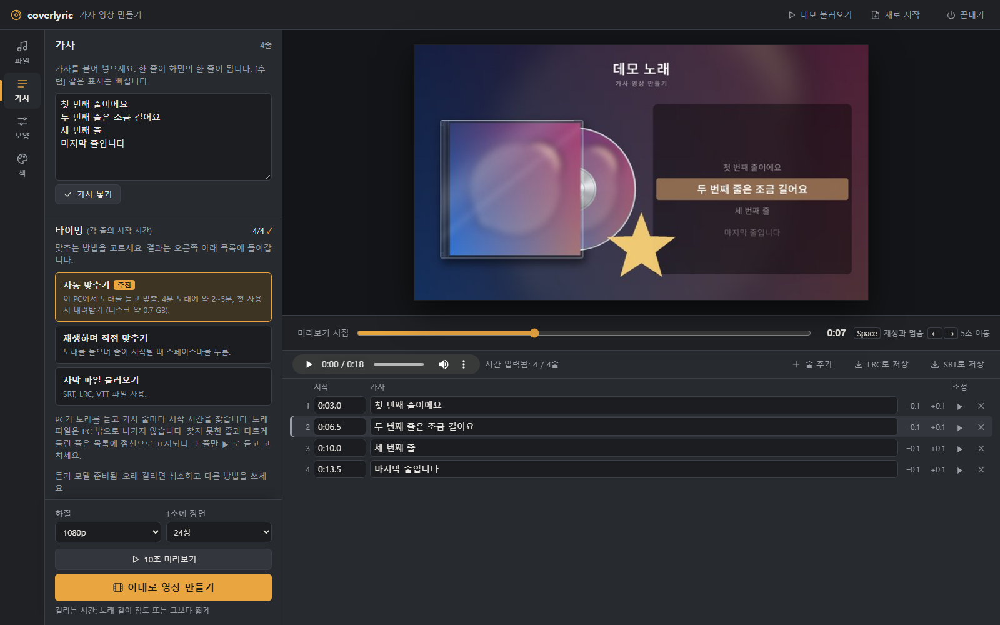
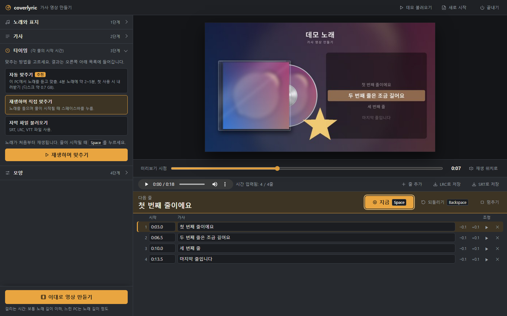
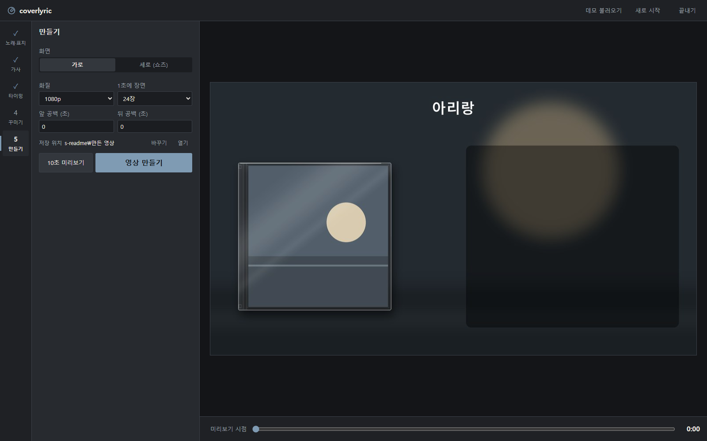

# coverlyric 가사 영상 만들기

[English](README.en.md)

노래, 앨범 표지, 가사로 가사 영상(mp4)을 만드는 Windows 프로그램. 내 PC에서 실행되고 브라우저에서
조작합니다.

**[coverlyric 내려받기 (ZIP)](https://github.com/NaNIsaac/coverlyric/archive/refs/heads/main.zip)**: 압축을 풀고 `가사영상 만들기.bat` 을 더블클릭합니다. 자세한 순서는 [사용법](#사용법)에 있습니다.


- [사용법](#사용법): 설치부터 영상 만들기까지
- [개발자·고급](#개발자고급): 명령줄, 프로젝트 파일, 테스트, 동작 방식

# 사용법

## 준비물

- Windows 10 또는 11 PC
- 노래 파일: mp3, wav, m4a, flac, ogg
- 앨범 표지: png, jpg, webp (정사각형 권장)
- 가사 텍스트

**최소 사양:** Windows 10/11 64비트, RAM 4 GB, CPU 2코어, 첫 실행 시 여유 디스크 500 MB.
자동 맞추기를 쓰면 처음 한 번 디스크 약 0.7 GB가 더 필요합니다. 그래픽 카드의 H.264 인코더(NVIDIA, Intel, AMD)가
동작하면 영상 압축에 쓰고, 없으면 CPU로 압축합니다. 메모리는
자동 맞추기에 약 1 GB, 영상 만들기에 여유 메모리에 따라 0.4~0.9 GB를 씁니다
([측정값](#메모리와-속도)).

## 1. 설치와 첫 실행

1. **[coverlyric 내려받기 (ZIP)](https://github.com/NaNIsaac/coverlyric/archive/refs/heads/main.zip)** 를 눌러 `coverlyric-main.zip` 을 받습니다.
2. ZIP 파일을 오른쪽 클릭하고 **압축 풀기** (또는 **모두 압축 풀기**)를 누릅니다.
3. `coverlyric-main` 폴더를 엽니다. 안에 같은 이름의 폴더가 또 있으면 그 폴더를 엽니다.
4. **`가사영상 만들기.bat`** 을 더블클릭합니다. 터미널 창이 열리고 진행 상황이 표시됩니다.
5. 첫 실행에는 uv, Python, ffmpeg와 필요한 패키지를 내려받습니다 (약 150 MB, 디스크 약 300 MB,
   보통 1~3분). 관리자 권한은 필요 없습니다. 끝날 때까지 터미널 창을 닫지 마세요.
6. 준비가 끝나면 브라우저에 **가사 영상 만들기** 페이지가 열립니다. 다음부터는 몇 초 안에 열립니다.

> **"Windows의 PC 보호" 창이 뜨면:** **추가 정보** → **실행**을 누릅니다.
>
> **백신이 막으면:** 이 폴더를 백신의 예외 목록에 넣거나 알림에서 **허용**을 누릅니다.

**데모 불러오기**를 누르면 연습용 노래, 표지, 가사 네 줄이 들어와 모든 단계를 시험할 수 있습니다.

설정은 왼쪽 세로 막대의 **파일**, **가사**, **모양**, **색** 네 묶음으로 나뉩니다. 누른 묶음만
옆에 펼쳐지고, 아래쪽 **이대로 영상 만들기**는 어느 묶음에서나 보입니다. 빨간 점이 붙은 묶음은
아직 빠진 것이 있습니다 (노래나 표지가 없거나, 시간이 없는 줄이 있음).

## 2. 노래와 표지


1. **노래 파일 고르기**로 노래를 고릅니다.
2. **앨범 표지 고르기**로 그림을 고릅니다. **표지 자르기** 창이 열리면 네모를 끌어 옮기고, 모서리로
   크기를, **확대** 막대로 배율을 정한 뒤 **확인**을 누릅니다. 오른쪽에 미리보기가 표시됩니다.
3. **노래 제목**과 **가수**를 입력합니다. 가수 칸을 비우면 영상에 표시하지 않습니다.

## 3. 가사


1. **가사** 묶음의 칸에 가사를 붙여 넣습니다. 한 줄이 화면의 한 줄이 됩니다. 긴 줄은 미리 나누세요.
2. `[후렴]`, `[Chorus]` 같은 표시는 자동으로 빠집니다.
3. **가사 넣기**를 누릅니다.

## 4. 타이밍 (각 줄의 시작 시간)

**가사** 묶음 아래쪽 **타이밍**에서 맞추는 방법을 고릅니다. 가사 묶음을 열면 미리보기 아래에 타이밍
목록이 나오고, 결과가 그 목록에 들어가며 목록에서 고칠 수 있습니다.

| 방법 | 걸리는 시간 | 노래 파일 전송 |
|---|---|---|
| 자동 맞추기 (추천) | 4분 노래에 약 2~5분 | 없음 |
| 재생하며 직접 맞추기 | 노래 길이만큼 | 없음 |
| 자막 파일 불러오기 | 즉시 | 없음 |

### 자동 맞추기



1. **파일**에서 노래를, **가사**에서 가사를 넣습니다.
2. **자동 맞추기** → **자동으로 맞추기**를 누릅니다. 진행 막대 아래에 단계와 진행률, 남은 시간이
   표시되고, 찾은 줄의 시간이 목록에 차례로 들어갑니다.
   - 처음 한 번은 듣기 프로그램을 설치하고 듣기 모델(464 MB)을 내려받습니다 (디스크 약 0.7 GB).
   - 노래는 PC 안에서만 처리되고, 밖으로 전송되지 않습니다.
3. 끝나면 확인이 필요한 줄이 점선 테두리와 설명으로 표시됩니다: 찾지 못한 줄(앞뒤 줄 사이
   시간으로 넣음), 앞 줄과 1초 안으로 붙은 줄, 가사와 다르게 들린 줄. 그 줄만 **▶** 로 듣고
   고칩니다.
4. **취소**를 누르면 실행 전 목록으로 돌아갑니다.

듣기 모델은 faster-whisper `small` 입니다. 측정 예 (12스레드 CPU, 4분 노래 63줄): 약 2분,
메모리 최대 1.04 GB, 59줄이 1초 안, 38줄이 0.3초 안으로 맞았습니다. 느린 PC에서는 더
걸립니다.

### 재생하며 직접 맞추기



1. **재생하며 직접 맞추기** → **재생하며 맞추기**를 누르면 노래가 처음부터 재생되고, 다음 줄이 크게
   표시됩니다.
2. 그 줄을 부르기 시작할 때 <kbd>Space</kbd> (또는 **지금**)를 누릅니다.
   <kbd>Backspace</kbd> 는 마지막 입력을 되돌리고, <kbd>Esc</kbd> 는 멈춥니다.
3. 목록에서 **−0.1** (빠르게) / **+0.1** (늦게)로 다듬고, **▶** 로 그 줄 직전부터 들어 봅니다.
4. 시간 칸에는 `10`, `10.5`, `1:05`, `1:05.3`, `0:01:05` 형식으로 직접 입력할 수 있습니다.

### 자막 파일 불러오기


SRT, LRC, VTT 파일이 있으면 **자막 파일 불러오기** → **자막 파일 고르기**를 누릅니다. 내 가사와
글자가 다른 줄은 테두리로 표시되고, **내 가사로**를 누르면 내 가사 글자로 바뀝니다. 자막 파일이
없으면 **채팅 AI용 프롬프트 복사**로 채팅 AI에게 SRT를 만들게 하고 그 답을 붙여 넣을 수 있습니다
(노래 파일이 그 AI 서비스로 전송되고, 시간이 틀리는 경우가 많습니다).

### 타이밍 저장

목록 아래 **LRC로 저장**, **SRT로 저장**으로 타이밍을 파일로 받습니다. 영상을 만들 때도 같은
파일이 영상 옆에 저장됩니다.

## 5. 모양과 색


오른쪽 그림은 영상의 한 장면이며, 설정을 바꾸면 바로 다시 그려집니다. 배치와 앨범, 글자, 움직이는
그림은 **모양** 묶음에, 띠 색과 배경은 **색** 묶음에 있습니다.

- **옮기기:** 그림 위에 마우스를 올리면 앨범, 가사, 제목, 재생 바에 점선 상자가 보입니다. 상자를 끌어 옮깁니다.
- **크기:** 상자 오른쪽 아래 모서리를 끕니다.
- **숫자 입력:** **위치와 크기** 표에 가로, 세로, 크기를 입력합니다.
- **위치·크기 처음대로:** 기본 배치로 되돌립니다.
- **앨범:** **CD 케이스** (CD가 반쯤 나와 회전) 또는 **둥근 표지**. **CD 보이기**, **CD 돌기**로 CD를 끄거나 멈춥니다.
- **글꼴:** 포함된 글꼴, 이 PC의 한글 글꼴, 또는 **다른 글꼴 파일...** (ttf, otf).
- **띠 색** (색 묶음): 현재 줄 뒤의 띠와 재생 바의 색.
- **배경 흐림 / 배경 어둡게** (색 묶음): 배경에 깔린 표지 그림의 흐림과 밝기.
- **배경 색감** (색 묶음): 배경을 **그대로**, **따뜻하게**, **차갑게**, **흑백**, 또는 **표지 색**(표지에서 가장
  눈에 띄는 색)으로 물들입니다.
- **움직이는 그림:** **움직이는 그림 추가**로 GIF 한 개 또는 그림 여러 장(png, jpg, webp)을
  넣으면 영상 위에서 반복 재생됩니다. 여러 장은 목록의 ↑ ↓ 로 순서를 바꾸고 ✕ 로 빼며,
  **1초에 N장**으로 빠르기를 정합니다. **앨범과 가사 위에 보이기**를 끄면 그 아래에 그려집니다.
  미리보기에서 끌어 옮기고 모서리로 크기를 바꿉니다.
- **제목과 가수 보이기**, **재생 바 넣기:** 켜기/끄기.
- **미리보기 시점:** 그림 아래 막대로 장면 시간을 고릅니다. 노래를 재생하면 미리보기가 재생
  위치를 따라갑니다.

## 6. 영상 만들기



1. 먼저 보려면 위의 **10초 미리보기**를 누릅니다. 미리보기 시점부터 10초를 작게 만들어 그림 자리에서
   재생하고, **미리보기 닫기**로 돌아옵니다.
2. **이대로 영상 만들기** → **확인**.
3. 노래의 어디까지 만들었는지(예: 0:04 / 0:18)와 그 시간의 가사 줄, 진행률과 남은 시간이
   표시됩니다. 걸리는 시간은 보통 노래 길이 이하이고, 느린 PC에서는 노래 길이 정도입니다.
4. 완료되면 **영상 폴더 열기**를 누릅니다.

프로그램 폴더 안 `만든 영상` 폴더에 생기는 파일:

| 파일 | 내용 |
|---|---|
| `노래 제목.mp4` | 영상 (1920x1080, 24 fps, H.264 + AAC) |
| `노래 제목.png` | 썸네일 (1280x720) |
| `노래 제목.lrc`, `노래 제목.srt` | 타이밍 |

## 7. 종료와 이어 하기

- 페이지의 **끝내기**를 누르거나 터미널 창을 닫으면 종료됩니다.
- 작업은 자동 저장되고, 다음 실행 때 이어집니다.
- **새로 시작**은 현재 작업을 지웁니다. 만든 영상은 남습니다.

## 사용 팁

- 각 묶음 제목 옆에 진행 상태가 표시됩니다 (예: 노래 ✓ 표지 ✓, 4줄, 4/4 ✓).
- <kbd>Space</kbd> 는 재생과 멈춤, <kbd>←</kbd> <kbd>→</kbd> 는 5초 이동입니다 (글자 칸 밖에서).
- 타이밍 목록의 줄을 누르면 미리보기가 그 줄의 시간으로 갑니다.
- 파일을 창 아무 곳에나 끌어 놓을 수 있습니다: 노래, 표지 사진(자르기 창이 열림), SRT·LRC·VTT
  자막, TXT 가사, 글꼴 파일. 움직이는 그림 칸 위에 놓은 그림은 움직이는 그림으로 들어갑니다.
- 줄을 지우면 알림에 **되돌리기**가 잠시 표시됩니다.

## 문제 해결

| 증상 | 조치 |
|---|---|
| 더블클릭해도 아무것도 뜨지 않음 | ZIP 안에서 실행하지 말고 압축을 푼 폴더에서 실행하세요. |
| "디스크 공간 부족" | 표시된 드라이브의 여유 공간을 늘린 뒤 다시 실행하세요. 첫 실행에는 500 MB가 필요합니다. |
| "내려받기 실패" 또는 "설치 실패" | 인터넷 연결을 확인하고 다시 실행하세요. |
| "프로그램이 오류로 끝났습니다" | 터미널 창의 오류 내용을 확인하세요. 해결되지 않으면 그 내용을 [이슈](https://github.com/NaNIsaac/coverlyric/issues)로 올리세요. |
| 브라우저가 열리지 않음 | 터미널 창에 표시된 `http://127.0.0.1:...` 주소를 브라우저에 붙여 넣으세요. |
| 글자가 네모로 표시됨 | 한글이 없는 글꼴입니다. 다른 글꼴을 고르세요. |
| "N번째 줄에 시간이 없습니다" | 타이밍 목록에서 그 줄의 시간을 넣거나 ✕ 로 지우세요. |
| "자동 맞추기 실패" | 표시된 원인을 확인하세요. 설치나 내려받기에서 실패했다면 인터넷 연결을 확인하고 다시 누르세요. 그동안 재생하며 직접 맞추기를 쓸 수 있습니다. |
| "영상 만들기 실패" | 버튼 아래에 원인과 할 일이 표시됩니다. 작업 프로세스가 종료되었다면 메모리 부족이므로 다른 프로그램을 닫고 다시 만드세요. 기록은 프로그램 폴더의 `coverlyric.log` 에 있습니다. |
| 소리와 가사가 어긋남 | 해당 줄을 −0.1 / +0.1 로 고치고 다시 만드세요. |

# 개발자·고급

## uv로 실행

[uv](https://docs.astral.sh/uv/)가 있으면 저장소 폴더에서 데모 노래의 한 장면을 그릴 수 있습니다:

<!-- test -->
```sh
uv run coverlyric still src/coverlyric/demo/demo.json --at 7 --out demo-still.png
```

`가사영상 만들기.bat` 은 `tools/start.ps1` 을 실행합니다. 이 스크립트는 여유 디스크를 확인하고,
uv가 없으면 `%LOCALAPPDATA%\coverlyric\uv` 에 설치한 뒤 `uv run --frozen --no-dev coverlyric` 으로
페이지를 엽니다.

## 명령줄

```sh
uv run coverlyric                         # 페이지 열기 (기본)
uv run coverlyric app --home <폴더>       # 작업과 영상을 <폴더>에 저장
uv run coverlyric still <project.json> --at 30 --out still.png
uv run coverlyric render <project.json> --out video.mp4 [--clip 10,20]
```

## 프로젝트 파일

페이지는 작업을 `작업 중/project.json` 에 저장합니다. 노래와 표지 경로, 줄마다 시작 시간과
글자, 모양 설정(`style`)이 들어 있습니다. 만든 영상은 `만든 영상/` 에 저장됩니다.

## 글꼴

포함된 글꼴은 SIL Open Font License 1.1이며, 라이선스 파일은 `src/coverlyric/fonts/` 에 글꼴과
함께 있습니다. 목록은 [README.en.md](README.en.md#fonts)에 있습니다.

## 테스트

```sh
uv run pytest
```

## 동작 방식

- 페이지는 `127.0.0.1` 에서만 접속되는 로컬 웹 서버입니다.
- 프레임은 Pillow로 그려 ffmpeg(imageio-ffmpeg 패키지)에 넘기고, H.264 + AAC mp4로 저장합니다.
  움직이지 않는 층은 한 번만 그리고, 같은 프레임은 다시 쓰며, 작업 프로세스가 4프레임씩 그려
  공유 메모리로 넘깁니다. 메모리에는 몇 묶음만 올라갑니다.
- 인코더는 h264_nvenc, h264_qsv, h264_amf 중 이 PC에서 동작하는 첫 번째, 없으면 libx264입니다.
  `COVERLYRIC_ENCODER` 환경 변수로 지정할 수 있습니다.
- 작업 프로세스 수는 영상 만들기를 시작할 때의 여유 메모리로 정합니다: 250 MB를 남기고
  150 MB당 1개, (코어 수 − 1) 이하, 최대 6개, 최소 1개. `COVERLYRIC_WORKERS` 환경 변수로 지정할
  수 있습니다 (1~8).
- 시작, 10% 단위 진행, 완료, 오류(종료 코드와 원인)는 터미널 창과 프로그램 폴더의
  `coverlyric.log` 에 기록됩니다.
- 자동 맞추기는 선택 의존성 `auto` (faster-whisper)를 처음 쓸 때 `uv run --extra auto` 로
  설치하고, 별도 프로세스에서 CPU로 노래를 받아 적은 뒤 단어 시간에 내 가사를 글자 단위로
  맞춥니다. 화면의 글자는 항상 내 가사이고, 받아 적은 글은 시간에만 쓰입니다.

## 메모리와 속도

12스레드 CPU, RAM 32 GB인 PC에서 측정 (2026-11-18, 인코더 libx264로 고정). 메모리는 python
프로세스와 ffmpeg의 private memory 합계 최댓값입니다.

| 노래 | 작업 프로세스 | 시간 | 최대 메모리 |
|---|---|---|---|
| 데모 18초 | 1 | 14.2 s | 416 MB |
| 데모 18초 | 2 | 9.0 s | 518 MB |
| 데모 18초 | 4 | 7.0 s | 775 MB |
| 노래의 60초 구간 | 1 | 28.9 s | 428 MB |
| 노래의 60초 구간 | 2 | 20.3 s | 552 MB |
| 노래의 60초 구간 | 4 | 16.9 s | 861 MB |

느린 CPU에서는 시간이 더 걸리지만 메모리는 거의 같습니다. RAM 8 GB, 12스레드 PC에서는 같은 크기의
60초 구간이 작업 프로세스 2개로 약 73 s, 4개로 약 60 s 걸렸습니다. 여유 메모리가 550 MB 미만이면
작업 프로세스 1개로 실행됩니다.

자동 맞추기 (RAM 32 GB PC, 노래 3분 48초, 모델 내려받은 뒤): `small` 약 120 s, 최대 1.04 GB.

## 라이선스

코드는 MIT (`LICENSE`), 글꼴은 각 글꼴의 라이선스를 따릅니다.
