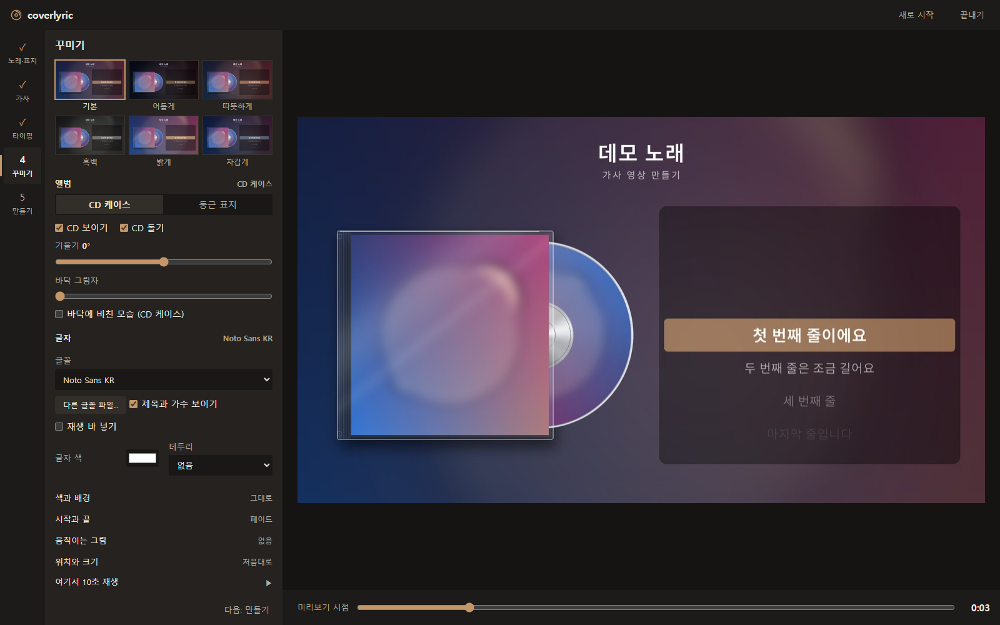

# coverlyric 가사 영상 만들기

[English](README.en.md)

노래, 앨범 표지, 가사로 가사 영상(mp4)을 만드는 Windows 프로그램입니다. 가사가 노래에 맞춰 흘러가고,
앨범은 CD 케이스나 둥근 표지로 옆에 놓입니다. 가사 시간은 이 PC 안에서 노래를 듣고 맞춥니다. 16:9 영상과
쇼츠(9:16), 1:1, 4:5 영상을 만듭니다.

## 설치

Windows 10/11 64비트, RAM 4 GB 이상이 필요합니다.

1. [최신 릴리스](https://github.com/NaNIsaac/coverlyric/releases/latest)에서 `coverlyric-setup.exe` 를
   내려받아 실행합니다. 관리자 권한은 필요 없습니다. "Windows의 PC 보호" 창이 뜨면 **추가 정보** →
   **실행**을 누릅니다.
2. 데이터 폴더(만든 영상, 작업 중인 노래, 설정, 기록을 두는 곳, 처음 값은 문서\coverlyric)를 고르고
   설치합니다.
3. 시작 메뉴의 **coverlyric** 을 엽니다. 첫 실행은 필요한 파일을 내려받아 1~3분 걸립니다.

새 버전도 같은 방법으로 설치합니다. 이전 버전 위에 설치되고, 데이터 폴더는 그대로입니다. 지울 때는
Windows 설정의 **앱**에서 지우며, 데이터 폴더는 남습니다.

## 첫 영상

1. **노래와 표지**: 노래 파일과 앨범 표지를 고르고 제목과 가수를 씁니다.
2. **가사**: 가사를 붙여 넣고 **가사 넣기**를 누릅니다. 한 줄이 화면의 한 줄이 됩니다.
3. **타이밍**: **자동으로 맞추기**를 누릅니다. 점선으로 표시된 줄만 듣고 고칩니다.
4. **꾸미기**: 미리보기에서 앨범과 가사를 끌어 옮기고, 앨범 모양, 글꼴, 색을 고릅니다.
5. **만들기**: **영상 만들기** → **확인**. 영상과 자막 파일(SRT, LRC)이 **저장 위치** 폴더에 저장됩니다.

빈 미리보기의 **데모로 둘러보기**는 연습용 노래와 표지, 가사로 바로 시작합니다.

## 더 보기

- [사용법](docs/guide.md): 화면마다 모든 설정, 쇼츠와 세로 영상, 문제 해결
- [명령줄](docs/cli.md): 소스에서 실행, 페이지 없이 만드는 명령
- [에이전트용](docs/agents.md): 명령으로 영상을 만드는 순서
- [이슈](https://github.com/NaNIsaac/coverlyric/issues): 문제가 계속되면 데이터 폴더의 `coverlyric.log` 를
  첨부합니다.

라이선스: 코드 MIT, 글꼴 SIL OFL 1.1.
