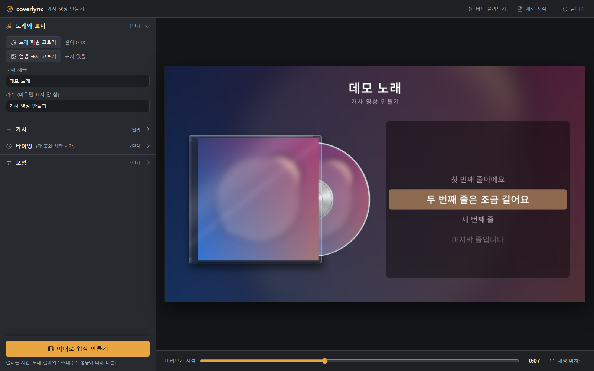
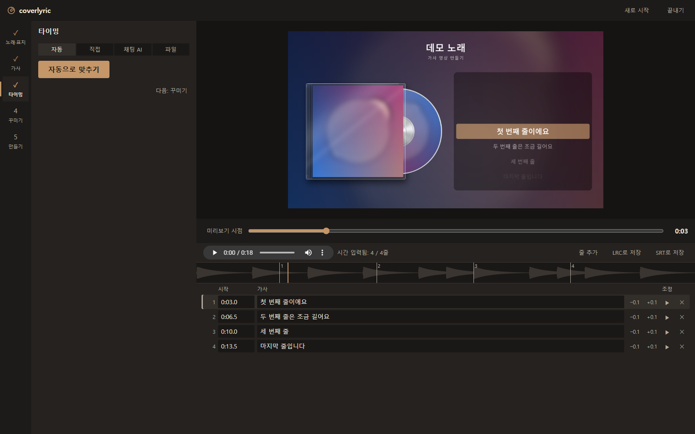
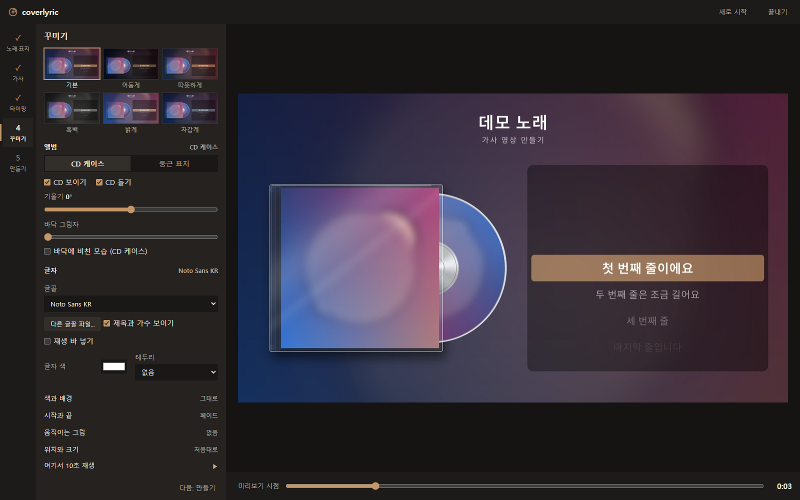
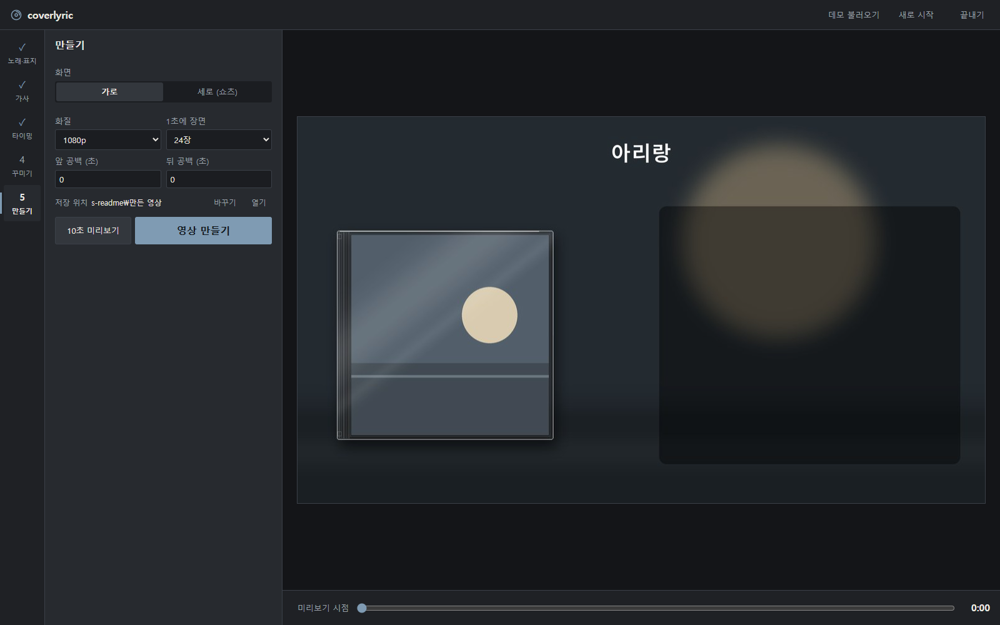
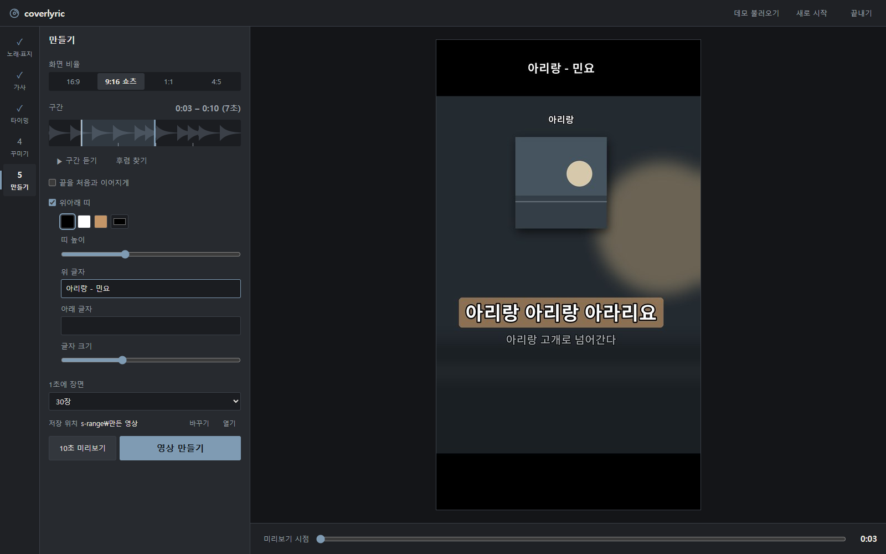

# Guide

[한국어](guide.md) · [Back](../README.en.md)

Installing is in the [README](../README.en.md#install). The page is in Korean; English names follow
the Korean labels in brackets.

## What you need

- Windows 10/11 64-bit, 4 GB of RAM, 500 MB of free disk (0.7 GB more for auto timing)
- Song: mp3, wav, m4a, flac, ogg
- Cover: png, jpg, webp (square works best)
- The lyrics as text

## First start and the data folder

- The first start downloads Python, ffmpeg and the packages (about 150 MB, about 300 MB on disk). It
  needs no administrator rights. Keep the terminal window open until it is done.
- If antivirus blocks it, add the program folder to its exceptions or click **Allow** on its notice.
- The data folder is chosen during the install (`Documents\coverlyric` at first). It holds `작업 중`
  (the song and project in progress), `만든 영상` (videos), `settings.json` and `coverlyric.log`. To
  use another folder, run the setup again and choose it. Files in the old folder are not moved.

## The page

The rail on the left has five steps: **노래·표지** (song and cover), **가사** (lyrics), **타이밍**
(timing), **꾸미기** (decorate) and **만들기** (make). Only the chosen step is open, and a finished
step's number turns into ✓. The **다음:** (next) link at the bottom of each step goes to the next one.

The right side is the preview: one frame of the video, redrawn on every change. The **미리보기 시점**
(preview time) bar under it picks the frame, and while the song plays the preview follows it. On the
**가사** and **타이밍** steps the song player and the timing list show under it.

**새로 시작** (start over) at the top clears the current work (finished videos stay), and **끝내기**
(quit) ends the program.

**데모로 둘러보기** (try the demo), in the empty preview, fills in a practice song, a cover and four
lines.

## 1 Song and cover (노래·표지)

- Pick the files with **노래 파일 고르기** (pick song) and **앨범 표지 고르기** (pick cover), and type
  **제목** (title) and **가수** (artist).
- **앨범 표지 고르기** opens **표지 자르기** (crop cover). Drag the square, resize it from a corner,
  set **확대** (zoom), then click **확인**.
- Leave the artist empty to keep it off the video.

## 2 Lyrics (가사)

- Paste the lyrics and click **가사 넣기** (add lyrics). Each line becomes one line on screen. A line
  wider than the band is drawn smaller, and if it is still too wide, on two rows. Such lines are
  underlined in the timing list, and the count shows above it.
- **대괄호 표시와 # 줄 빼기** (drop bracket marks and # lines; on at first, saved with the work): drops
  blank lines, lines starting with `#` and square-bracket marks such as `[후렴]` or
  `[Verse 1 — Conversational, rhythmic]`. A mark inside a line is removed and the rest of the line
  stays. Round brackets such as `(echo)` stay. Off, the lyrics go in as typed, with only blank lines
  left out. The same applies to the chat-AI answer and to subtitle files.

## 3 Timing (타이밍)

Pick the way: **자동** (automatic), **직접** (tap along), **채팅 AI** (chat AI) or **파일** (file).
The times go into the timing list, where they can be edited.

### Automatic (자동)

- With the song and lyrics in, click **자동으로 맞추기** (time automatically). The bar shows the
  phase, the percentage and the time left, and the list fills in as lines are found. **취소** (cancel)
  brings back the list as it was.
- A 4-minute song takes about 2-5 minutes. The first run downloads the listening model (464 MB). The
  song is processed on this PC only.
- At the start it picks the largest model that fits in the free memory (small, base, then tiny) and
  says under the bar when it uses a smaller one. When not even tiny fits, the memory message comes at
  once. When memory runs short while listening, it tries again with a smaller model. A smaller model
  places lines less exactly, so check the result once more.
- Lines to check get a dashed border and a note: lines not found (given a time between their
  neighbours), lines within 1 second of the line before, and lines heard differently from the lyrics.
  Lines not found at the end share the time left before the song ends.
- When a chorus repeats, the lines written once are placed first and each chorus is matched only to
  what was heard between them, so a first chorus that was not heard does not take a later one.
- When it is done, **SRT로 저장** (save SRT) next to the result line saves the timing.

### Tap along (직접)

- **재생하며 맞추기** plays the song from the start and shows the next line large.
- Press <kbd>Space</kbd> (or **지금**, now) as each line starts. <kbd>Backspace</kbd> (**되돌리기**)
  undoes the last one, <kbd>Esc</kbd> (**멈추기**) stops.

### Chat AI (채팅 AI)

- It uses almost no memory on this PC, so it suits a PC with little memory.
- **채팅 AI용 프롬프트 복사** copies the prompt; give it to a chat AI with the song file, paste the
  SRT it returns into **받은 자막** and click **넣기**.
- The song file is sent to that AI service. Its times are often wrong, so check the list.

### File (파일)

- Open an SRT, LRC or VTT file with **자막 파일 고르기**.
- Lines whose text differs from the lyrics are outlined; **내 가사로** replaces their text with yours.

### The timing list

- Clicking a row moves the preview to its time. **▶** plays from just before that line.
- Fine-tune with **−0.1** / **+0.1**. The time box takes `10`, `10.5`, `1:05`, `1:05.3` or
  `0:01:05`.
- **줄 추가** adds a line and ✕ removes one. A removed line shows **되돌리기** (undo) in a notice for a
  few seconds.
- **LRC로 저장** and **SRT로 저장** save the timing as a file in the save folder and show the path. The
  same files are saved next to each video.

## 4 Decorate (꾸미기)

Drag the dashed boxes on the preview to move the album, the lyrics and the title; drag the lower-right
corner to resize. The look cards at the top (**기본** default, **어둡게** dark, **따뜻하게** warm, **흑백**
black and white, **밝게** light, **차갑게** cool) are drawn from the current frame; a click sets the
band colour and the background (tone, blur, darkness, edges) at once and leaves the album, the text
and the places as they are. Below them the settings sit in folded groups, each with a short summary of its values next to
its name. **여기서 10초 재생** (play 10 s from here) makes 10 seconds from the preview time at small size
and plays it in place of the still.

- **배경 영상** (background video): **영상 고르기** takes a video file (mp4, mov, webm, mkv, avi)
  that fills the frame in place of the cover, with the title and the artist at the top and the line
  being sung, with the next one small under it, at the bottom. It works for the wide and the
  upright videos. The video starts with the song (an upright video: with its part); **영상 시작
  (초)** moves it later (+) or earlier (-) in seconds. A video shorter than the song starts again
  (**처음부터 다시**) or stops on its last frame (**마지막 장면에서 멈춤**). The sound is the song;
  **노래 대신 영상 소리** uses the video's own sound instead.
  - **부르는 글자만 강조** (light the letter being sung): only that letter, in the **강조 색**
    (highlight colour), a little larger. A line without letter times lights its letters one after
    another from its start.
  - **글자 색** (text colour), **테두리** (edge: shadow or none), **가사 뒤 띠** (band behind the
    lines: none, light paper or dark) with **띠 진하기** (how solid), and **가사 자리** (bottom,
    middle, or **더 아래**, lower: for a video with room under its picture, in the part of a Short
    its caption and music line can cover). It starts as white text with a shadow and no band; on the paper band a dark text colour
    without an edge reads best.
  - The album, background, moving picture and place settings do not apply over a video. **배경
    영상 빼기** goes back to the cover.
- **앨범** (album)
  - **CD 케이스** (CD half out, spinning) or **둥근 표지** (round cover). **CD 보이기** and
    **CD 돌기** hide or stop the CD.
  - **플레이어** (player): drawn like a music app's playing screen. On the left the cover with rounded
    corners and a see-through CD half out behind it; under the cover the title, an "artist — album"
    line, a progress bar that fills with the song with the time played and the time left, and a row of
    player buttons, which are only drawn. The blurred cover behind is darker and nearer grey. On the
    right the lyrics, left aligned: the line being sung white and bold, the others grey, blurring
    towards the bottom. The **앨범** (album) field shown then gives "title - Single" when empty, and
    **표지 위 날짜** (date on the cover, such as 2026.06.23) puts a date badge on the cover's top left.
    Tilt, floor shadow, band colour, the title on top and the progress bar option do nothing in the
    player.
  - **기울기** (tilt, -40° to 40°): turns the album about its upright axis.
  - **바닥 그림자** (floor shadow): how strong the soft shadow on the floor under the album is.
  - **바닥에 비친 모습 (CD 케이스)** (reflection): the case mirrored on the floor under it, fading out
    (the CD out of the case is not mirrored).
- **글자** (text)
  - **글꼴** (font): a bundled font, a Korean font installed on the PC, or **다른 글꼴 파일...**
    (ttf, otf).
  - **제목과 가수 보이기**, **재생 바 넣기**: title and progress bar on or off.
  - **글자 색**, **테두리** (none, outline, shadow), **테두리 색**: colour of the lyrics, title and
    artist, with an outline or shadow that keeps them readable on a light cover.
- **색과 배경** (colour and background)
  - **띠 색** (band colour): the band behind the current line and the progress bar. **표지 색으로**
    takes the cover's most telling colour, darkened (light lyrics) or lightened (dark lyrics) a little
    if needed so the lyric colour stays readable on it.
  - **배경 흐림**, **배경 어둡게**: blur and darkness of the cover in the background.
  - **가장자리 어둡게** (vignette): darkens the background towards the edges and corners, which draws
    the eye to the album and the lyrics.
  - **빛이 천천히 움직이기** (drifting light): a soft light crosses the frame slowly, about once a
    minute. On by default.
  - Background tone: **그대로** (as is), **따뜻하게** (warm), **차갑게** (cool), **흑백** (black and
    white) or **표지 색** (the cover's most telling colour).
- **시작과 끝** (start and end)
  - **시작·끝 페이드** (fade in and out): the video fades in from black over 0.5 s and out to black
    over the last 1.5 s, with the sound. On by default.
  - **긴 전주에 제목 보이기** (title in a long intro): when the first lyric comes more than 8 s in, the
    title and the artist fade in large where the lyric panel is, around the middle of the intro, and
    fade out before the lyrics come in. When they come and go stretches with the length of the intro.
    On by default.
  - **시작 제목 화면** (opening title card; none, 2-5 s): the title and the artist fill the middle of
    the frame at the start, then fade into the usual frame over 0.8 s; the first lyric ends it sooner.
    It uses the lyric colour and edge.
- **움직이는 그림** (moving picture): **움직이는 그림 추가** adds one GIF or several images (png, jpg,
  webp) that loop over the video. Reorder with ↑ ↓, remove with ✕, set the speed with **1초에 N장**
  (frames per second). Turn off **앨범과 가사 위에 보이기** to draw it below them. **움직이는 그림 빼기**
  removes them all.
- **위치와 크기** (place and size): numbers for the across, down and size of the album, the lyrics, the
  title, the moving picture and the progress bar. **위치·크기 처음대로** resets the layout.

## 5 Make (만들기)

- **화면 비율** (ratio): 16:9 (the default), **9:16 쇼츠**, **1:1** or **4:5**. The ratios other than
  16:9 are in [Shorts and upright videos](#shorts-and-upright-videos).
- **화질** (1080p or 720p) and **1초에 장면** (24 or 30 frames a second): size and frame rate of the
  video. A 720p file is smaller and a little faster to make.
- **앞 공백 (초)** and **뒤 공백 (초)** (silence before and after, 0 to 10 s in 0.5 s steps): silent
  time before and after the song. If the song starts on its first sound, put 1 or so before it.
  During the silence before, only the cover and the title show, and the song and the lyrics start that
  much later. During the silence after, the last frame stays. The fade is at the start and the end of
  the whole video, silence included. The saved lyric times do not change; only the LRC and SRT files
  saved next to the video are moved to the video's clock.
- **저장 위치** (save folder): where videos and timing files go; `만든 영상` in the data folder at
  first. A folder picked with **바꾸기** (change) stays for the next run, **열기** opens it, and
  **기본으로** (default) goes back to `만든 영상`. If the picked folder is gone (an unplugged USB drive),
  files go to `만든 영상`.
- **10초 미리보기** (10-second preview) makes 10 seconds from the preview time at small size and plays
  it in place of the still; **미리보기 닫기** (close the preview) closes it.
- **영상 만들기** (make video) → **확인**. While it runs, the page shows how far into the song the video
  is made, the lyric there and the time left. **그만 만들기** stops it. It usually takes no longer than
  the song.
- Before it starts, it checks that the save folder's drive has room for the video (about 36 MB a
  minute at 1080p, half that at 720p). If not, it says how much is needed and how much is free, and
  does not start.
- When the video is done, the done line shows the file name, the video's length and the file size,
  with **재생** (play) and **폴더 열기** (open folder). If it fails, **다시 만들기** (make again) under
  the reason starts it again.
- If the program is closed or the PC goes off while a video is being made, the next start shows
  "지난번 영상 만들기가 끝나지 않았습니다" (the last video was not finished) with **다시 만들기**. The
  half-made file (`*.making.mp4`) is removed then.
- If a video of the same name is open in a player, the new one is saved as `title (2).mp4`.

Files in the save folder:

| File | Content |
|---|---|
| `title.mp4` | video (1920x1080 and 24 fps by default, H.264 + AAC) |
| `title.png` | thumbnail (1280x720) |
| `title.lrc`, `title.srt` | timing |

### Shorts and upright videos

**9:16 쇼츠** (Shorts, 1080x1920), **1:1** (1080x1080) and **4:5** (1080x1350) are drawn for a phone.

- 30 frames a second, H.264. The quality and silence fields, and the **앨범**, **시작과 끝**,
  **움직이는 그림** and **위치와 크기** groups in **꾸미기**, apply to 16:9 only and are hidden.
- The title and the artist at the top, the cover under them, the line being sung large on a band in
  the middle and the next line small under it. The lower the frame, the smaller everything gets, the
  text less so. The lyrics get an outline (changeable in the **글자** group of **꾸미기**).
- In 9:16 the bottom fifth and the right 120 pixels stay empty: Shorts covers them with its buttons
  and caption.
- The picture starts at once, without rising from black; only the sound fades in and out over 0.3 s.
- The file is `title_shorts.mp4`, `title_1x1.mp4` or `title_4x5.mp4`, saved apart from the 16:9
  video, with a thumbnail in the same ratio and the subtitle files beside it.
- The first change away from 16:9 sets 30 frames a second and the lyric outline; changes between the
  other ratios keep them. Choosing **16:9** again goes back to 24 frames a second.

**구간** (part): which part of the song the video holds; at first, 30 seconds from the first lyric
line.

- The light stretch on the waveform is the part. Drag the bar at either end; it lands on the nearest
  line start (the end bar also on the song's end). Its start, end and length are shown above.
- A press inside the part moves the preview there. The preview time bar moves inside the part only,
  and the part's first line is in the middle, large, from the first frame.
- **▶ 구간 듣기** (play the part) plays the part once; a second press stops it.
- **후렴 찾기** (find the chorus) looks in the timed lyrics for the block of lines repeated most (the
  more lines repeat together, the higher it ranks) and moves the part, at its length, to start on that
  block's first line. Spaces, punctuation and case do not count. When no line comes back it only says
  so.
- **반복 구간 찾기** (find loop sections) lists parts a whole number of bars long, near the current
  length, the strongest opening first. A press on one makes it the part, turns on **끝을 처음과
  이어지게** and plays it on repeat; a second press stops it. It needs the `align` extra and says how
  to install it when missing ([command line](cli.en.md)).
- **끝을 처음과 이어지게** (join the end to the start) blends the last 0.5 s, picture and sound, with
  the moments before the part's start, so the last frame equals the first and a video on repeat does
  not jump. The sound then does not fade out at the end.

**CD와 글자 강조** (disc and letter highlight): all off at first.

- **가사 뒤에 도는 CD** (turning CD behind the lyrics): the 16:9 video's CD turns behind the line being
  sung instead of the cover. It is darkened by 40 percent so white letters read on it, and turns the
  whole number of times nearest one turn per `spin` seconds (7 at first) over the part, so a video on
  repeat meets itself. The title and the artist go between the top band and the disc, also with a top
  text.
- **오래된 CD** (old CD), shown only with the CD on: the print peels at a few places of its edges and in
  two or three small flakes, with seven very faint scratches. Colours and brightness stay; the wear is
  the same every time.
- **부르는 글자만 노랗게** (light the letter being sung): the line being sung is drawn at 106 pixels with
  a shadow and no band; only the letter being sung is yellow (#ffd23f) and 1.3 times its size, and goes
  back to white at its size when the next letter starts. The letter times come from `letters` in the
  project file ([command line](cli.en.md)). A line without letter times is drawn all white.

**위아래 띠** (bands): off at first; switching them on shows their fields.

- Colour: black (the default), white, the lyric band's colour, or any colour from the last field.
- **띠 높이** (height): 5 to 25 percent of the frame each. The cover and the lyrics shrink to fit
  between the bands.
- **위 글자**, **아래 글자** (top and bottom text): one line each, dark on a light band and white on a
  dark one, made smaller when larger than **글자 크기** (text size) or taller than the band.
- With a top text, the title and the artist are not drawn inside the frame, so they do not show twice.
- In 9:16 the bottom band's text can be covered by the Shorts caption; put what must be seen on the
  top band.

## Quitting and coming back

- **끝내기** on the page, or closing the terminal window, quits.
- Work is saved as you go and comes back on the next start.

## Keys and dropping files

- <kbd>Space</kbd> plays and pauses, <kbd>←</kbd> <kbd>→</kbd> move 5 seconds (outside text boxes).
- Files can be dropped anywhere on the page: song, cover, SRT/LRC/VTT, TXT lyrics, font files. Images
  dropped on the moving-picture box become moving pictures.

## Problems

| Symptom | What to do |
|---|---|
| "uv를 찾지 못했습니다" (uv not found) | Install again with `coverlyric-setup.exe`. The data folder stays. |
| "디스크 공간 부족" (not enough disk) | Free space on the drive it names and start again. For a video, a save folder on another drive also works. |
| "프로그램이 오류로 끝났습니다" (program ended with an error) | Post the error from the terminal window as an [issue](https://github.com/NaNIsaac/coverlyric/issues). On the first start, check the internet connection first. |
| The browser does not open | Paste the `http://127.0.0.1:...` address from the terminal window into the browser. |
| Letters show as boxes | The font has no Korean; pick another. |
| "N번째 줄에 시간이 없습니다" (line N has no time) | Give that line a time in the list or remove it with ✕. |
| "메모리가 부족해 자동 맞추기를 하지 못했습니다" (not enough memory for auto timing) | Click **채팅 AI로 맞추기** (chat AI) or **재생하며 직접 맞추기** (tap along) under the message. With other programs closed, auto timing can run again. |
| "자동 맞추기를 하지 못했습니다" (auto timing failed) | Check the internet connection and try again. The details are in `coverlyric.log`. |
| "노래 파일을 읽을 수 없습니다", "그림 파일을 읽을 수 없습니다" (file cannot be read) | Pick another file. The song and cover already in place stay. |
| "메모리가 부족해 영상을 만들지 못했습니다" (not enough memory to make the video) | Close other programs and make it again; 720p uses less memory. |
| "메모리가 부족해 움직이는 그림 없이 만들었습니다" (made without the moving picture) | The video is made. To keep the moving picture, close other programs and make it again. |
| "메모리가 부족해 720p로 만들었습니다" (made at 720p) | The video is made at 720p. For 1080p, close other programs and make it again. |
| "영상 만들기 실패" (video failed) | Read the reason under the button and click **다시 만들기**. |
| Sound and lyrics drift apart | Move that line with −0.1 / +0.1 and make it again. |

The log is `coverlyric.log` in the data folder. If a problem stays, attach it to an issue.
