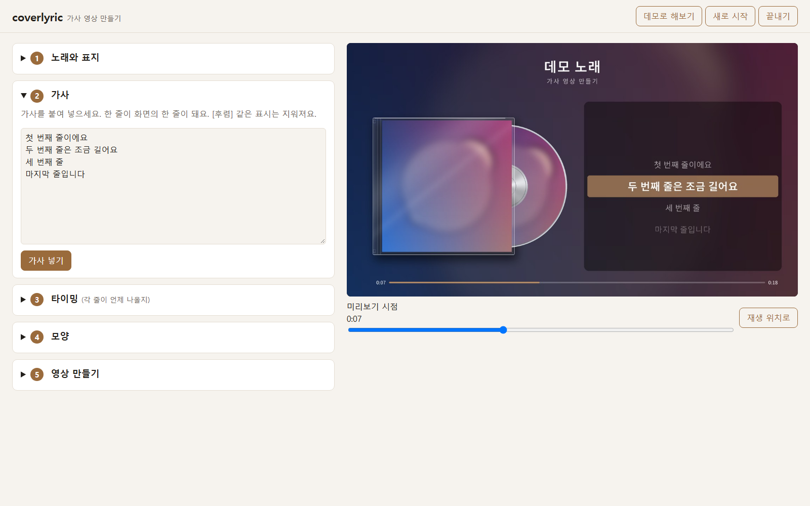

# Full guide

[한국어](guide.md) · [Back](../README.en.md)

The page is in Korean; English names follow the Korean labels in brackets.

## What you need

- Windows 10/11 64-bit, 4 GB of RAM, 500 MB of free disk (0.7 GB more for auto timing)
- Song: mp3, wav, m4a, flac, ogg
- Cover: png, jpg, webp (square works best)
- The lyrics as text

## The page

The controls sit in four groups on the left rail: **파일** (files), **가사** (lyrics and timing),
**모양** (look) and **색** (colour). Only the chosen group is open, and **이대로 영상 만들기** (make)
shows in every group. A red dot marks a group that still lacks something (no song or cover, or a
line without a time).

## First start

- `가사영상 만들기.bat` downloads uv, Python, ffmpeg and the packages once (about 150 MB, about 300 MB
  on disk). It needs no administrator rights.
- If the extracted folder holds another folder of the same name, run the `.bat` inside it.
- If antivirus blocks it, add the folder to its exceptions or click **Allow** on its notice.
- **데모 불러오기** (load demo) fills in a practice song, a cover and four lines.

## Song and cover

- **앨범 표지 고르기** (pick cover) opens **표지 자르기** (crop cover). Drag the square, resize it from
  a corner, set **확대** (zoom), then click **확인**.
- Leave the artist empty to keep it off the video.

## Lyrics

- Each line becomes one line on screen. A line wider than the band is drawn smaller, and if it is
  still too wide, on two rows. Such lines are underlined in the timing list, and the count shows
  above it.
- Marks such as `[후렴]` or `[Chorus]` are dropped.

## Timing

Pick the way under **타이밍**, lower in the **가사** group. The times go into the timing list under
the preview, where they can be edited.

### Auto timing (자동 맞추기)

- With the song and lyrics in, click **자동 맞추기** → **자동으로 맞추기**. The bar shows the phase,
  the percentage and the time left, and the list fills in as lines are found.
- A 4-minute song takes about 2-5 minutes. The first run downloads the listening model (464 MB).
- The song is processed on this PC only.
- Lines to check get a dashed border and a note: lines not found (given a time between their
  neighbours), lines within 1 second of the line before, and lines heard differently from the lyrics.
- **취소** (cancel) brings back the list as it was.

### Tap along (재생하며 직접 맞추기)

- **재생하며 맞추기** plays the song from the start and shows the next line large.
- Press <kbd>Space</kbd> (or **지금**) as each line starts. <kbd>Backspace</kbd> undoes the last one,
  <kbd>Esc</kbd> stops.
- Fine-tune with **−0.1** / **+0.1** and listen from just before a line with **▶**.
- The time box takes `10`, `10.5`, `1:05`, `1:05.3` or `0:01:05`.

### Subtitle file (자막 파일 불러오기)

- Open an SRT, LRC or VTT file with **자막 파일 고르기**.
- Lines whose text differs from the lyrics are outlined; **내 가사로** replaces their text with yours.
- **채팅 AI용 프롬프트 복사** copies a prompt that asks a chat AI for an SRT. The song is sent to that
  service, and its times are often wrong.

### Saving the timing

**LRC로 저장** and **SRT로 저장** save the timing as a file. The same files are saved next to each
video.

## Look and colour (모양, 색)

The preview is one frame of the video and redraws on every change. Band, background and lyric colours
are in the **색** group, the rest in **모양**.

- **Move and resize:** drag the dashed boxes in the preview; drag the lower-right corner to resize.
  The **위치와 크기** table takes numbers; **위치·크기 처음대로** resets the layout.
- **Album:** **CD 케이스** (CD half out, spinning) or **둥근 표지** (round cover). **CD 보이기** and
  **CD 돌기** hide or stop the CD.
- **Font:** a bundled font, a Korean font installed on the PC, or **다른 글꼴 파일...** (ttf, otf).
- **띠 색:** colour of the band behind the current line and of the progress bar. **표지 색으로**
  beside it takes the cover's most telling colour, darkened a little if needed so the white line stays
  readable.
- **배경 흐림 / 배경 어둡게:** blur and darkness of the cover in the background.
- **가장자리 어둡게** (vignette): darkens the background towards the edges and corners, which draws
  the eye to the album and the lyrics.
- **배경 색감** (background tone): **그대로** (as is), **따뜻하게** (warm), **차갑게** (cool), **흑백**
  (black and white) or **표지 색** (tinted with the cover's most telling colour).
- **글자 색**, **테두리** (none, outline, shadow), **테두리 색:** colour of the lyrics, title and artist, with an outline or
  shadow that keeps them readable on a light cover.
- **움직이는 그림** (moving picture): one GIF or several images (png, jpg, webp) loop over the video.
  Reorder with ↑ ↓, remove with ✕, set the speed with **1초에 N장** (frames per second). Turn off
  **앨범과 가사 위에 보이기** to draw it below them.
- **제목과 가수 보이기**, **재생 바 넣기:** title and progress bar on or off.
- **시작·끝 페이드** (fade in and out): the video fades in from black over 0.5 s and out to black
  over the last 1.5 s, with the sound. On by default.
- **Preview time:** the slider under the preview picks the frame; while the song plays the preview
  follows it.

## Making the video

- **화질** (1080p or 720p) and **1초에 장면** (24 or 30 frames a second): size and frame rate of the
  video. A 720p file is smaller and a little faster to make.
- **10초 미리보기** (10-second preview) makes 10 seconds from the preview time at small size and
  plays it in place of the still; **미리보기 닫기** closes it.
- **이대로 영상 만들기** → **확인**. While it runs, the page shows how far into the song the video is
  made, the lyric there and the time left. **그만 만들기** stops it.
- It usually takes no longer than the song.
- If a video of the same name is open in a player, the new one is saved as `title (2).mp4`.

Files in `만든 영상`:

| File | Content |
|---|---|
| `title.mp4` | video (1920x1080 and 24 fps by default, H.264 + AAC) |
| `title.png` | thumbnail (1280x720) |
| `title.lrc`, `title.srt` | timing |

## Quitting and coming back

- **끝내기** on the page, or closing the terminal window, quits.
- Work is saved as you go and comes back on the next start.
- **새로 시작** (start over) clears the current work. Finished videos stay.

## Keys and tips

- Each group's title shows its state (for example 노래 ✓ 표지 ✓, 4줄, 4/4 ✓).
- <kbd>Space</kbd> plays and pauses, <kbd>←</kbd> <kbd>→</kbd> move 5 seconds (outside text boxes).
- Clicking a row in the timing list moves the preview to its time.
- Files can be dropped anywhere on the page: song, cover, SRT/LRC/VTT, TXT lyrics, font files. Images
  dropped on the moving-picture box become moving pictures.
- Deleting a line shows **되돌리기** (undo) in a notice for a few seconds.

## Problems

| Symptom | What to do |
|---|---|
| Nothing happens on double-click | Run it from the extracted folder, not from inside the ZIP. |
| "디스크 공간 부족" (not enough disk) | Free space on the drive it names and start again. |
| "내려받기 실패", "설치 실패" (download or install failed) | Check the internet connection and start again. |
| "프로그램이 오류로 끝났습니다" (program ended with an error) | Post the error from the terminal window as an [issue](https://github.com/NaNIsaac/coverlyric/issues). |
| The browser does not open | Paste the `http://127.0.0.1:...` address from the terminal window into the browser. |
| Letters show as boxes | The font has no Korean; pick another. |
| "N번째 줄에 시간이 없습니다" (line N has no time) | Give that line a time in the list or remove it with ✕. |
| "자동 맞추기 실패" (auto timing failed) | Read the reason shown. For an install or download failure, check the connection and try again. |
| "영상 만들기 실패" (video failed) | Read the reason under the button. If a worker process ended, memory ran out: close other programs and make it again. |
| Sound and lyrics drift apart | Move that line with −0.1 / +0.1 and make it again. |

The log is `coverlyric.log` in the program folder.
