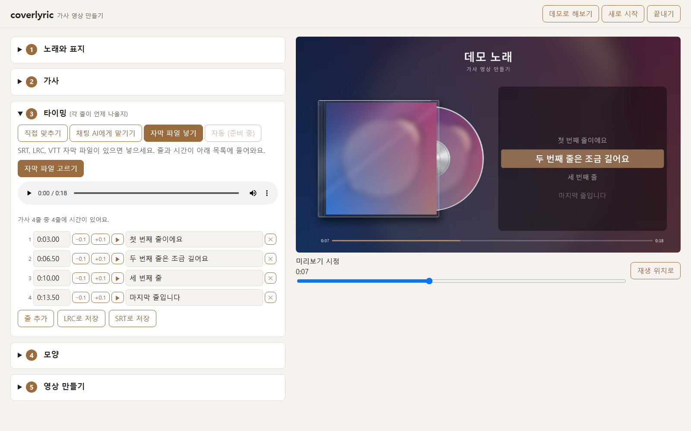

# 자세한 사용법

[English](guide.en.md) · [처음으로](../README.md)

## 준비물

- Windows 10/11 64비트, RAM 4 GB, 여유 디스크 500 MB (자동 맞추기를 쓰면 0.7 GB 더)
- 노래 파일: mp3, wav, m4a, flac, ogg
- 앨범 표지: png, jpg, webp (정사각형 권장)
- 가사 텍스트

## 화면

설정은 왼쪽 세로 막대의 **파일**, **가사**, **모양**, **색** 네 묶음에 있습니다. 누른 묶음만 펼쳐지고,
**이대로 영상 만들기**는 어느 묶음에서나 보입니다. 빨간 점이 붙은 묶음은 아직 빠진 것이 있습니다
(노래나 표지가 없거나, 시간이 없는 줄이 있음).

## 첫 실행

- `가사영상 만들기.bat` 은 처음 한 번 uv, Python, ffmpeg와 필요한 패키지를 내려받습니다 (약 150 MB,
  디스크 약 300 MB). 관리자 권한은 필요 없습니다.
- 압축 푼 폴더 안에 같은 이름의 폴더가 또 있으면 그 안의 `.bat` 을 실행합니다.
- 백신이 막으면 이 폴더를 예외 목록에 넣거나 알림에서 **허용**을 누릅니다.
- **데모 불러오기**를 누르면 연습용 노래, 표지, 가사 네 줄이 들어옵니다.

## 노래와 표지

- **앨범 표지 고르기**를 누르면 **표지 자르기** 창이 열립니다. 네모를 끌어 옮기고, 모서리로 크기를,
  **확대** 막대로 배율을 정한 뒤 **확인**을 누릅니다.
- 가수 칸을 비우면 영상에 가수를 표시하지 않습니다.

## 가사

- 한 줄이 화면의 한 줄이 됩니다. 띠보다 긴 줄은 글자를 작게 그리고, 그래도 길면 두 줄로 나눕니다.
  그런 줄은 타이밍 목록에서 밑줄로 표시되고, 목록 위에 긴 줄 수가 나옵니다.
- `[후렴]`, `[Chorus]` 같은 표시는 자동으로 빠집니다.

## 타이밍

**가사** 묶음 아래쪽 **타이밍**에서 방법을 고릅니다. 맞춘 시간은 미리보기 아래 타이밍 목록에
들어가고, 목록에서 고칠 수 있습니다.

### 자동 맞추기

- 노래와 가사를 넣은 뒤 **자동 맞추기** → **자동으로 맞추기**를 누릅니다. 진행 막대 아래에 단계,
  진행률, 남은 시간이 표시되고, 찾은 줄의 시간이 목록에 차례로 들어갑니다.
- 4분 노래에 약 2~5분 걸립니다. 처음 한 번은 듣기 모델(464 MB)을 내려받습니다.
- 노래는 이 PC 안에서만 처리됩니다.
- 확인이 필요한 줄은 점선 테두리와 설명으로 표시됩니다: 찾지 못한 줄(앞뒤 줄 사이 시간으로 넣음),
  앞 줄과 1초 안으로 붙은 줄, 가사와 다르게 들린 줄.
- **취소**를 누르면 실행 전 목록으로 돌아갑니다.

### 재생하며 직접 맞추기

- **재생하며 맞추기**를 누르면 노래가 처음부터 재생되고 다음 줄이 크게 표시됩니다.
- 그 줄을 부르기 시작할 때 <kbd>Space</kbd> (또는 **지금**)를 누릅니다. <kbd>Backspace</kbd> 는
  마지막 입력을 되돌리고, <kbd>Esc</kbd> 는 멈춥니다.
- 목록의 **−0.1** / **+0.1** 로 다듬고, **▶** 로 그 줄 직전부터 들어 봅니다.
- 시간 칸에는 `10`, `10.5`, `1:05`, `1:05.3`, `0:01:05` 형식으로 입력합니다.

### 자막 파일 불러오기

- SRT, LRC, VTT 파일을 **자막 파일 고르기**로 엽니다.
- 내 가사와 글자가 다른 줄은 테두리로 표시되고, **내 가사로**를 누르면 내 가사 글자로 바뀝니다.
- **채팅 AI용 프롬프트 복사**는 채팅 AI에게 SRT를 만들게 하는 글을 복사합니다. 노래 파일이 그 AI
  서비스로 전송되고, 시간이 틀리는 경우가 많습니다.

### 타이밍 저장

**LRC로 저장**, **SRT로 저장**으로 타이밍을 파일로 받습니다. 영상을 만들 때도 같은 파일이 영상 옆에
저장됩니다.

## 모양과 색

미리보기는 영상의 한 장면이며, 설정을 바꾸면 바로 다시 그려집니다. 띠, 배경, 가사 글자의 색은
**색** 묶음에, 나머지는 **모양** 묶음에 있습니다.

- **옮기기와 크기:** 미리보기 위의 점선 상자를 끌어 옮기고, 오른쪽 아래 모서리로 크기를 바꿉니다.
  **위치와 크기** 표에 숫자로 넣을 수도 있습니다. **위치·크기 처음대로**는 기본 배치로 되돌립니다.
- **앨범:** **CD 케이스** (CD가 반쯤 나와 회전) 또는 **둥근 표지**. **CD 보이기**, **CD 돌기**로
  CD를 끄거나 멈춥니다. **기울기** (-25° ~ 25°)는 앨범을 세로축으로 돌려 비스듬히 보이게 합니다.
- **글꼴:** 포함된 글꼴, 이 PC의 한글 글꼴, 또는 **다른 글꼴 파일...** (ttf, otf).
- **띠 색:** 현재 줄 뒤의 띠와 재생 바의 색.
- **배경 흐림 / 배경 어둡게:** 배경에 깔린 표지 그림의 흐림과 밝기.
- **글자 색**, **테두리** (없음, 외곽선, 그림자), **테두리 색:** 가사 글자의 색. 밝은 표지에서는 외곽선이나
  그림자를 넣으면 잘 읽힙니다.
- **움직이는 그림:** GIF 한 개 또는 그림 여러 장(png, jpg, webp)을 넣으면 영상 위에서 반복
  재생됩니다. 목록의 ↑ ↓ 로 순서를 바꾸고 ✕ 로 빼며, **1초에 N장**으로 빠르기를 정합니다.
  **앨범과 가사 위에 보이기**를 끄면 그 아래에 그려집니다.
- **제목과 가수 보이기**, **재생 바 넣기:** 켜기/끄기.
- **시작·끝 페이드:** 영상이 검은 화면에서 0.5초 동안 나타나고, 끝 1.5초 동안 검은 화면으로
  사라집니다. 소리도 같이 커지고 작아집니다. 기본으로 켜져 있습니다.
- **미리보기 시점:** 그림 아래 막대로 장면 시간을 고릅니다. 노래를 재생하면 미리보기가 따라갑니다.

## 영상 만들기

- **화질** (1080p, 720p), **1초에 장면** (24장, 30장): 만들 영상의 크기와 초당 장면 수. 720p는 파일이
  작고 조금 빨리 만들어집니다.
- **10초 미리보기**는 미리보기 시점부터 10초를 작게 만들어 그림 자리에서 재생합니다. **미리보기
  닫기**로 돌아옵니다.
- **이대로 영상 만들기** → **확인**. 진행 중에는 노래의 몇 분까지 만들었는지, 그 곳의 가사, 남은
  시간이 표시됩니다. **그만 만들기**로 멈춥니다.
- 걸리는 시간은 보통 노래 길이 이하입니다.
- 같은 이름의 영상이 열려 있으면 `노래 제목 (2).mp4` 로 저장됩니다.

`만든 영상` 폴더에 생기는 파일:

| 파일 | 내용 |
|---|---|
| `노래 제목.mp4` | 영상 (기본 1920x1080, 24 fps, H.264 + AAC) |
| `노래 제목.png` | 썸네일 (1280x720) |
| `노래 제목.lrc`, `노래 제목.srt` | 타이밍 |

## 끝내기와 이어 하기

- 페이지의 **끝내기**를 누르거나 터미널 창을 닫으면 종료됩니다.
- 작업은 자동 저장되고, 다음 실행 때 이어집니다.
- **새로 시작**은 현재 작업을 지웁니다. 만든 영상은 남습니다.

## 단축키와 팁

- 각 묶음 제목 옆에 진행 상태가 표시됩니다 (예: 노래 ✓ 표지 ✓, 4줄, 4/4 ✓).
- <kbd>Space</kbd> 는 재생과 멈춤, <kbd>←</kbd> <kbd>→</kbd> 는 5초 이동입니다 (글자 칸 밖에서).
- 타이밍 목록의 줄을 누르면 미리보기가 그 줄의 시간으로 갑니다.
- 파일을 창 아무 곳에나 끌어 놓을 수 있습니다: 노래, 표지, SRT·LRC·VTT 자막, TXT 가사, 글꼴 파일.
  움직이는 그림 칸 위에 놓은 그림은 움직이는 그림으로 들어갑니다.
- 줄을 지우면 알림에 **되돌리기**가 잠시 표시됩니다.

## 문제 해결

| 증상 | 조치 |
|---|---|
| 더블클릭해도 아무것도 뜨지 않음 | ZIP 안이 아니라 압축을 푼 폴더에서 실행합니다. |
| "디스크 공간 부족" | 표시된 드라이브의 여유 공간을 늘린 뒤 다시 실행합니다. |
| "내려받기 실패", "설치 실패" | 인터넷 연결을 확인하고 다시 실행합니다. |
| "프로그램이 오류로 끝났습니다" | 터미널 창의 오류 내용을 [이슈](https://github.com/NaNIsaac/coverlyric/issues)로 올립니다. |
| 브라우저가 열리지 않음 | 터미널 창에 표시된 `http://127.0.0.1:...` 주소를 브라우저에 붙여 넣습니다. |
| 글자가 네모로 표시됨 | 한글이 없는 글꼴입니다. 다른 글꼴을 고릅니다. |
| "N번째 줄에 시간이 없습니다" | 타이밍 목록에서 그 줄의 시간을 넣거나 ✕ 로 지웁니다. |
| "자동 맞추기 실패" | 표시된 원인을 확인합니다. 설치나 내려받기 실패는 인터넷 연결을 확인하고 다시 누릅니다. |
| "영상 만들기 실패" | 버튼 아래의 원인을 확인합니다. 작업 프로세스가 종료되었다면 메모리 부족이므로 다른 프로그램을 닫고 다시 만듭니다. |
| 소리와 가사가 어긋남 | 그 줄을 −0.1 / +0.1 로 고치고 다시 만듭니다. |

기록은 프로그램 폴더의 `coverlyric.log` 에 있습니다.
