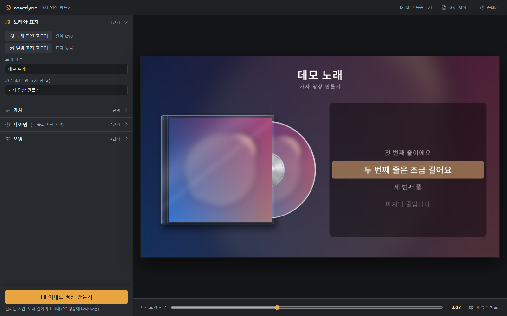
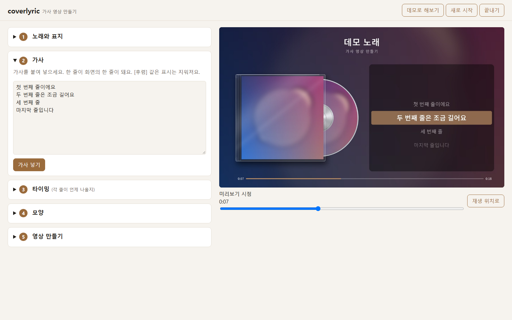
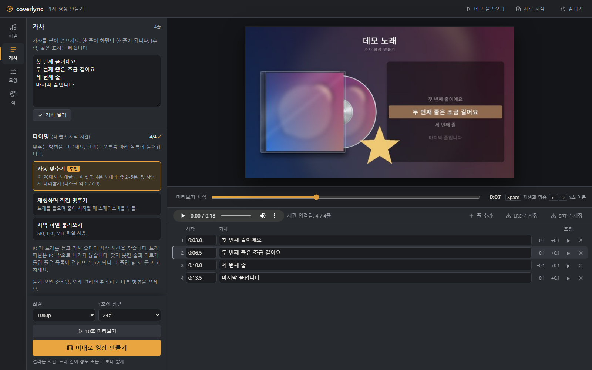
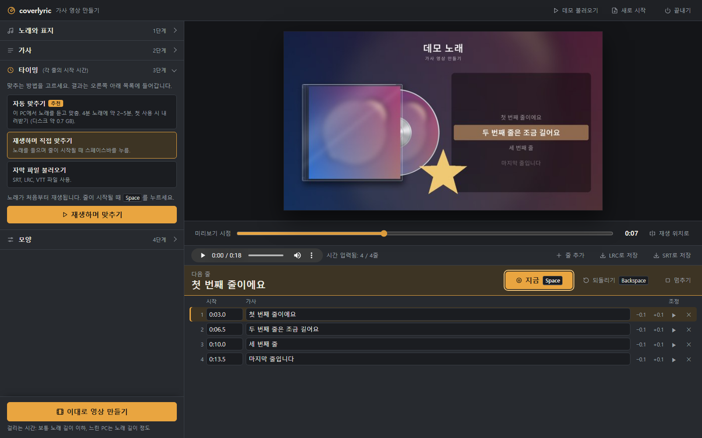
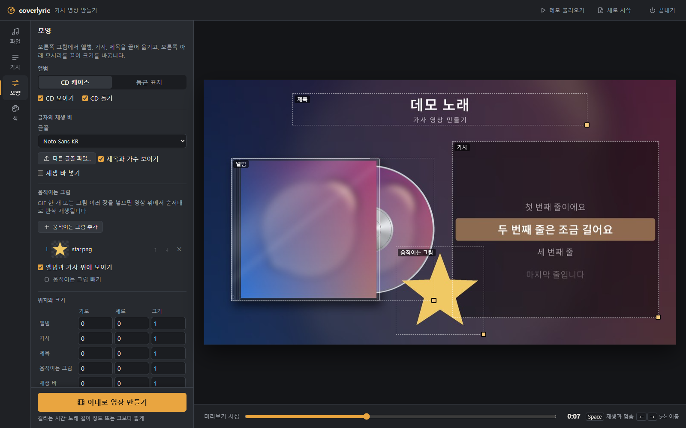
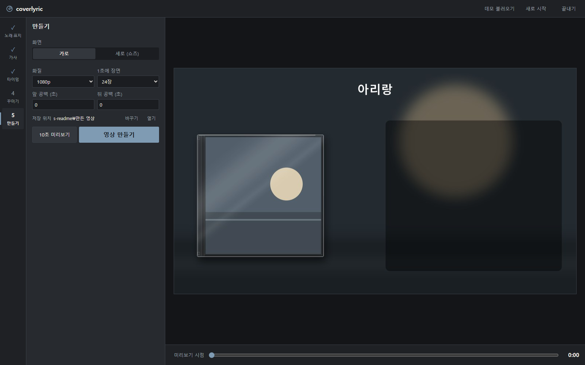
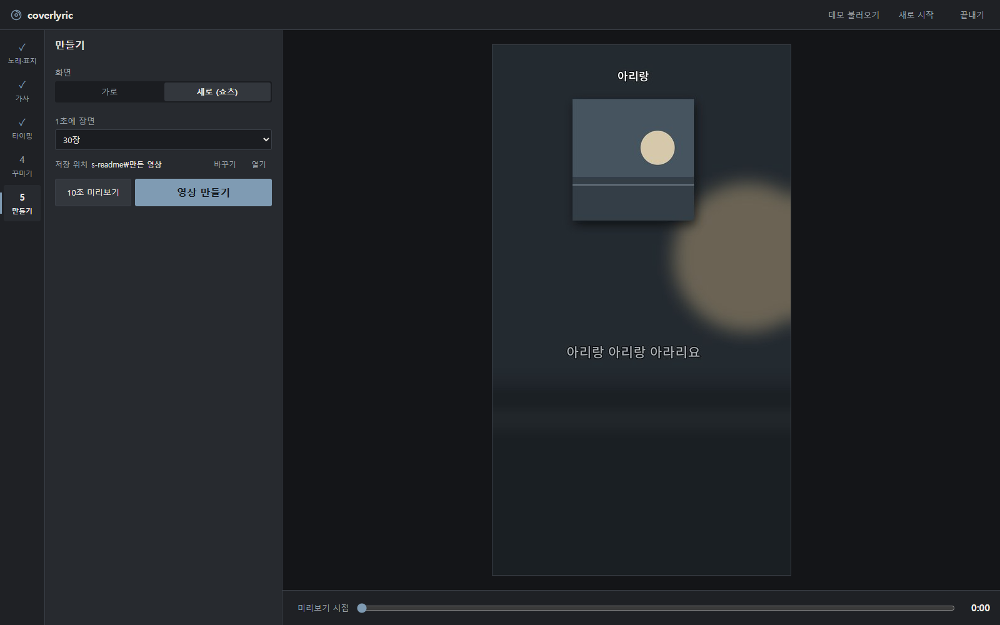

# 자세한 사용법

[English](guide.en.md) · [처음으로](../README.md)

## 준비물

- Windows 10/11 64비트, RAM 4 GB, 여유 디스크 500 MB (자동 맞추기를 쓰면 0.7 GB 더)
- 노래 파일: mp3, wav, m4a, flac, ogg
- 앨범 표지: png, jpg, webp (정사각형 권장)
- 가사 텍스트

## 화면

설정은 왼쪽 세로 막대의 **파일**, **가사**, **모양**, **색** 네 묶음에 있습니다. 누른 묶음만 펼쳐지고,
**이대로 영상 만들기**는 어느 묶음에서나 보입니다. 빨간 점이 붙은 묶음은 아직 빠진 것이 있습니다
(노래나 표지가 없거나, 시간이 없는 줄이 있음).

## 첫 실행

- `가사영상 만들기.bat` 은 처음 한 번 uv, Python, ffmpeg와 필요한 패키지를 내려받습니다 (약 150 MB,
  디스크 약 300 MB). 관리자 권한은 필요 없습니다.
- 압축 푼 폴더 안에 같은 이름의 폴더가 또 있으면 그 안의 `.bat` 을 실행합니다.
- 백신이 막으면 이 폴더를 예외 목록에 넣거나 알림에서 **허용**을 누릅니다.
- **데모 불러오기**를 누르면 연습용 노래, 표지, 가사 네 줄이 들어옵니다.

## 노래와 표지

- **앨범 표지 고르기**를 누르면 **표지 자르기** 창이 열립니다. 네모를 끌어 옮기고, 모서리로 크기를,
  **확대** 막대로 배율을 정한 뒤 **확인**을 누릅니다.
- 가수 칸을 비우면 영상에 가수를 표시하지 않습니다.

## 가사

- 한 줄이 화면의 한 줄이 됩니다. 띠보다 긴 줄은 글자를 작게 그리고, 그래도 길면 두 줄로 나눕니다.
  그런 줄은 타이밍 목록에서 밑줄로 표시되고, 목록 위에 긴 줄 수가 나옵니다.
- 빈 줄, `#` 으로 시작하는 줄, `[후렴]`, `[Verse 1 — Conversational, rhythmic]` 같은 대괄호 표시는
  빠집니다. 줄 안의 대괄호 표시만 지우고 나머지는 남깁니다. 둥근 괄호 `(echo)` 는 남습니다.
  붙여 넣은 자막과 자막 파일에도 같게 적용됩니다.
- 이렇게 빼는 것은 **가사 넣기** 옆의 **대괄호 표시와 # 줄 빼기**로 켜고 끕니다 (처음에는 켜짐, 작업과
  함께 저장). 끄면 쓴 그대로 넣고 빈 줄만 뺍니다. 가사 넣기, 채팅 AI 답 붙여 넣기, 자막 파일에 같이
  적용됩니다.

## 타이밍

**가사** 묶음 아래쪽 **타이밍**에서 방법을 고릅니다. 맞춘 시간은 미리보기 아래 타이밍 목록에
들어가고, 목록에서 고칠 수 있습니다.

### 자동 맞추기

- 노래와 가사를 넣은 뒤 **자동 맞추기** → **자동으로 맞추기**를 누릅니다. 진행 막대 아래에 단계,
  진행률, 남은 시간이 표시되고, 찾은 줄의 시간이 목록에 차례로 들어갑니다.
- 4분 노래에 약 2~5분 걸립니다. 처음 한 번은 듣기 모델(464 MB)을 내려받습니다.
- 시작할 때 남은 메모리에 맞는 가장 큰 모델(small, base, tiny 순)을 고르고, 더 작은 모델을 쓰면
  진행 막대 아래에 표시됩니다. tiny도 들어가지 않으면 바로 메모리 부족 안내가 나옵니다.
  듣는 중에 메모리가 모자라면 더 작은 모델로 다시 합니다.
  작은 모델은 시간이 덜 정확하니 결과를 한 번 더 확인합니다.
- 노래는 이 PC 안에서만 처리됩니다.
- 확인이 필요한 줄은 점선 테두리와 설명으로 표시됩니다: 찾지 못한 줄(앞뒤 줄 사이 시간으로 넣음),
  앞 줄과 1초 안으로 붙은 줄, 가사와 다르게 들린 줄.
- **취소**를 누르면 실행 전 목록으로 돌아갑니다.

### 재생하며 직접 맞추기

- **재생하며 맞추기**를 누르면 노래가 처음부터 재생되고 다음 줄이 크게 표시됩니다.
- 그 줄을 부르기 시작할 때 <kbd>Space</kbd> (또는 **지금**)를 누릅니다. <kbd>Backspace</kbd> 는
  마지막 입력을 되돌리고, <kbd>Esc</kbd> 는 멈춥니다.
- 목록의 **−0.1** / **+0.1** 로 다듬고, **▶** 로 그 줄 직전부터 들어 봅니다.
- 시간 칸에는 `10`, `10.5`, `1:05`, `1:05.3`, `0:01:05` 형식으로 입력합니다.

### 자막 파일 불러오기

- SRT, LRC, VTT 파일을 **자막 파일 고르기**로 엽니다.
- 내 가사와 글자가 다른 줄은 테두리로 표시되고, **내 가사로**를 누르면 내 가사 글자로 바뀝니다.

### 채팅 AI로 맞추기

- 이 PC의 메모리를 거의 쓰지 않아 메모리가 적은 PC에 맞습니다.
- **채팅 AI용 프롬프트 복사**로 프롬프트를 복사해 노래 파일과 함께 채팅 AI에 주고, 받은 자막(SRT)을
  **받은 자막** 칸에 붙여 넣은 뒤 **넣기**를 누릅니다.
- 노래 파일이 그 AI 서비스로 전송됩니다. 시간이 틀리는 경우가 많아 목록에서 확인합니다.

### 타이밍 저장

**LRC로 저장**, **SRT로 저장**은 타이밍을 저장 위치 폴더에 파일로 저장하고, 저장한 경로를 보여 줍니다.
자동 맞추기가 끝나면 결과 문장 옆의 **SRT로 저장**으로도 저장합니다. 영상을 만들 때도 같은 파일이
영상 옆에 저장됩니다.

## 모양과 색

미리보기는 영상의 한 장면이며, 설정을 바꾸면 바로 다시 그려집니다. 띠, 배경, 가사 글자의 색은
**색** 묶음에, 나머지는 **모양** 묶음에 있습니다.

- 옮기기와 크기: 미리보기 위의 점선 상자를 끌어 옮기고, 오른쪽 아래 모서리로 크기를 바꿉니다.
  **위치와 크기** 표에 숫자로 넣을 수도 있습니다. **위치·크기 처음대로**는 기본 배치로 되돌립니다.
- **앨범:** **CD 케이스** (CD가 반쯤 나와 회전) 또는 **둥근 표지**. **CD 보이기**, **CD 돌기**로
  CD를 끄거나 멈춥니다. **기울기** (-40° ~ 40°)는 앨범을 세로축으로 돌려 비스듬히 보이게 합니다.
- **글꼴:** 포함된 글꼴, 이 PC의 한글 글꼴, 또는 **다른 글꼴 파일...** (ttf, otf).
- **띠 색:** 현재 줄 뒤의 띠와 재생 바의 색. 옆의 **표지 색으로**는 표지에서 가장 눈에 띄는 색을 고르고,
  가사 글자 색이 잘 보이도록 필요하면 조금 어둡게(밝은 글자) 또는 밝게(어두운 글자) 씁니다.
- **바닥 그림자:** 앨범 아래 바닥에 부드러운 그림자를 깝니다 (CD 케이스, 둥근 표지 모두).
- **바닥에 비친 모습:** CD 케이스가 바닥에 비친 것처럼 아래에 흐려지며 비칩니다 (CD 케이스만; 나와
  있는 CD는 비치지 않습니다).
- **배경 흐림 / 배경 어둡게:** 배경에 깔린 표지 그림의 흐림과 밝기.
- **가장자리 어둡게:** 배경의 가장자리와 모서리를 가운데보다 어둡게 해 앨범과 가사로 눈이 가게 합니다.
- **배경 색감:** 배경을 **그대로**, **따뜻하게**, **차갑게**, **흑백**, 또는 **표지 색**(표지에서 가장 눈에 띄는
  색)으로 물들입니다.
- **글자 색**, **테두리** (없음, 외곽선, 그림자), **테두리 색:** 가사와 제목, 가수 이름 글자의 색. 밝은 표지에서는 외곽선이나
  그림자를 넣으면 잘 읽힙니다.
- **움직이는 그림:** GIF 한 개 또는 그림 여러 장(png, jpg, webp)을 넣으면 영상 위에서 반복
  재생됩니다. 목록의 ↑ ↓ 로 순서를 바꾸고 ✕ 로 빼며, **1초에 N장**으로 빠르기를 정합니다.
  **앨범과 가사 위에 보이기**를 끄면 그 아래에 그려집니다.
- **제목과 가수 보이기**, **재생 바 넣기:** 켜기/끄기.
- **시작 제목 화면:** 영상 처음 2-5초 동안 제목과 가수를 화면 가운데에 크게 보여 주고, 마지막 0.8초에
  평소 화면으로 서서히 바뀝니다. 첫 가사가 그보다 먼저 나오면 거기서 끝납니다. 글자 색과 테두리는 가사와 같습니다.
- **시작·끝 페이드:** 영상이 검은 화면에서 0.5초 동안 나타나고, 끝 1.5초 동안 검은 화면으로
  사라집니다. 소리도 같이 커지고 작아집니다. 기본으로 켜져 있습니다.
- **미리보기 시점:** 그림 아래 막대로 장면 시간을 고릅니다. 노래를 재생하면 미리보기가 따라갑니다.

## 영상 만들기

- **화질** (1080p, 720p), **1초에 장면** (24장, 30장): 만들 영상의 크기와 초당 장면 수. 720p는 파일이
  작고 조금 빨리 만들어집니다.
- **앞 공백**, **뒤 공백** (0~10초, 0.5초 단위): 노래 앞과 뒤에 넣는 소리 없는 시간. 앞 공백 동안은
  표지와 제목만 보이고, 노래와 가사는 그만큼 늦게 시작합니다. 뒤 공백 동안은 마지막 화면이
  이어집니다. 페이드는 공백을 포함한 영상 전체의 처음과 끝에 들어갑니다. 저장된 가사 시간은 그대로이고,
  영상 옆에 저장되는 LRC·SRT 파일만 영상 시간에 맞춰 늦춰집니다.
- **10초 미리보기**는 미리보기 시점부터 10초를 작게 만들어 그림 자리에서 재생합니다. **미리보기
  닫기**로 돌아옵니다.
- **이대로 영상 만들기** → **확인**. 진행 중에는 노래의 몇 분까지 만들었는지, 그 곳의 가사, 남은
  시간이 표시됩니다. **그만 만들기**로 멈춥니다.
- 걸리는 시간은 보통 노래 길이 이하입니다.
- 같은 이름의 영상이 열려 있으면 `노래 제목 (2).mp4` 로 저장됩니다.
- **저장 위치:** 영상과 타이밍 파일을 저장하는 폴더. **바꾸기**로 고른 폴더는 다음에 실행해도
  그대로이고, **기본으로**는 `만든 영상` 으로 되돌립니다. 고른 폴더가 없어지면 (빼 놓은 USB 등)
  `만든 영상` 에 저장합니다. 다 만들면 완료 줄에 만든 파일 이름이 나옵니다.

저장 위치 폴더에 생기는 파일:

| 파일 | 내용 |
|---|---|
| `노래 제목.mp4` | 영상 (기본 1920x1080, 24 fps, H.264 + AAC) |
| `노래 제목.png` | 썸네일 (1280x720) |
| `노래 제목.lrc`, `노래 제목.srt` | 타이밍 |

## 쇼츠

**만들기**의 **화면**에서 **세로 (쇼츠)** 를 고르면 YouTube 쇼츠용 세로 영상을 만듭니다.

- 1080x1920, 1초에 30장, H.264. 화질과 앞뒤 공백 칸은 쓰지 않아 숨겨집니다.
- 위에 제목과 가수, 그 아래 표지, 가운데에 부르는 줄이 띠 위에 크게, 그 아래 다음 줄이 작게 나옵니다.
  가사에는 테두리가 들어갑니다(**색과 배경**에서 바꿀 수 있습니다).
- 아래쪽 5분의 1과 오른쪽 끝 120 픽셀은 쇼츠의 버튼과 설명이 덮는 자리라 비워 둡니다.
- 영상은 검은 화면에서 떠오르지 않고 바로 시작하고, 소리만 처음과 끝 0.3초에 커지고 줄어듭니다.
- 앨범 모양, 시작과 끝, 움직이는 그림, 위치와 크기는 가로 영상에만 쓰여 **꾸미기**에서 숨겨집니다.
- 파일 이름은 `제목_shorts.mp4` 입니다. 옆에 세로 썸네일과 자막 파일이 저장됩니다.

**가로**를 다시 고르면 처음의 가로 영상(1초에 24장)으로 돌아갑니다.

## 끝내기와 이어 하기

- 페이지의 **끝내기**를 누르거나 터미널 창을 닫으면 종료됩니다.
- 작업은 자동 저장되고, 다음 실행 때 이어집니다.
- **새로 시작**은 현재 작업을 지웁니다. 만든 영상은 남습니다.

## 단축키와 팁

- 각 묶음 제목 옆에 진행 상태가 표시됩니다 (예: 노래 ✓ 표지 ✓, 4줄, 4/4 ✓).
- <kbd>Space</kbd> 는 재생과 멈춤, <kbd>←</kbd> <kbd>→</kbd> 는 5초 이동입니다 (글자 칸 밖에서).
- 타이밍 목록의 줄을 누르면 미리보기가 그 줄의 시간으로 갑니다.
- 파일을 창 아무 곳에나 끌어 놓을 수 있습니다: 노래, 표지, SRT·LRC·VTT 자막, TXT 가사, 글꼴 파일.
  움직이는 그림 칸 위에 놓은 그림은 움직이는 그림으로 들어갑니다.
- 줄을 지우면 알림에 **되돌리기**가 잠시 표시됩니다.

## 문제 해결

| 증상 | 조치 |
|---|---|
| 더블클릭해도 아무것도 뜨지 않음 | ZIP 안이 아니라 압축을 푼 폴더에서 실행합니다. |
| "디스크 공간 부족" | 표시된 드라이브의 여유 공간을 늘린 뒤 다시 실행합니다. |
| "내려받기 실패", "설치 실패" | 인터넷 연결을 확인하고 다시 실행합니다. |
| "프로그램이 오류로 끝났습니다" | 터미널 창의 오류 내용을 [이슈](https://github.com/NaNIsaac/coverlyric/issues)로 올립니다. |
| 브라우저가 열리지 않음 | 터미널 창에 표시된 `http://127.0.0.1:...` 주소를 브라우저에 붙여 넣습니다. |
| 글자가 네모로 표시됨 | 한글이 없는 글꼴입니다. 다른 글꼴을 고릅니다. |
| "N번째 줄에 시간이 없습니다" | 타이밍 목록에서 그 줄의 시간을 넣거나 ✕ 로 지웁니다. |
| "메모리가 부족해 자동 맞추기를 하지 못했습니다" | 안내 아래의 **채팅 AI로 맞추기**나 **재생하며 직접 맞추기**를 누릅니다. 다른 프로그램을 닫으면 자동 맞추기를 다시 할 수 있습니다. |
| "자동 맞추기를 하지 못했습니다" | 인터넷 연결을 확인하고 다시 누릅니다. 자세한 내용은 `coverlyric.log` 에 있습니다. |
| "노래 파일을 읽을 수 없습니다", "그림 파일을 읽을 수 없습니다" | 다른 파일을 고릅니다. 지금 들어 있는 노래와 표지는 그대로 남습니다. |
| "메모리가 부족해 영상을 만들지 못했습니다" | 다른 프로그램을 닫고 다시 만듭니다. 720p로 고르면 메모리를 덜 씁니다. |
| "메모리가 부족해 움직이는 그림 없이 만들었습니다" | 영상은 만들어졌습니다. 움직이는 그림이 필요하면 다른 프로그램을 닫고 다시 만듭니다. |
| "메모리가 부족해 720p로 만들었습니다" | 영상은 720p로 만들어졌습니다. 1080p가 필요하면 다른 프로그램을 닫고 다시 만듭니다. |
| "영상 만들기 실패" | 버튼 아래의 원인을 확인합니다. |
| 소리와 가사가 어긋남 | 그 줄을 −0.1 / +0.1 로 고치고 다시 만듭니다. |

기록은 프로그램 폴더의 `coverlyric.log` 에 있습니다.
